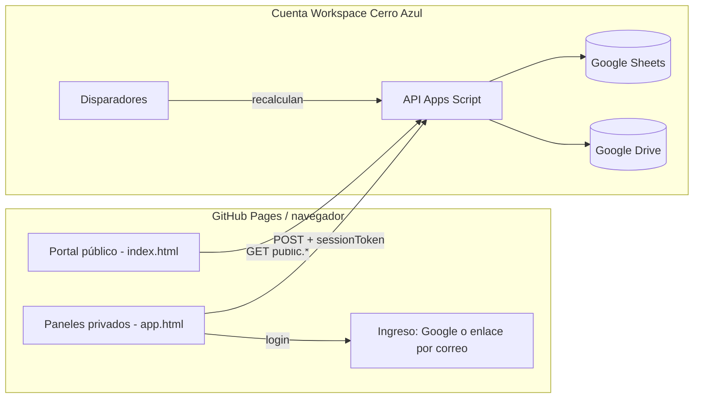
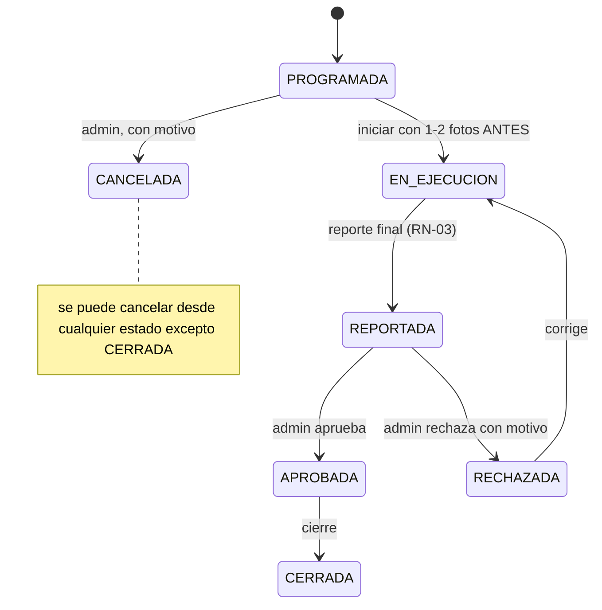

# SPEC — Portal de Control de Mantenimientos Cerro Azul

Versión 1.3 · Nov 9, 2026 · @FAbio Lesmes

## 0. Cómo usar este SPEC

Este documento es la fuente de verdad para construir el portal; si el código y el SPEC difieren, manda el SPEC. Está escrito para que un agente de programación (Claude Code u otro) lo implemente por fases, sin decisiones abiertas salvo las listadas en el Anexo D.

**Instrucciones para el agente implementador**

1. Antes de escribir código, genera en el repositorio `docs/SPEC.md` (este documento), `CLAUDE.md`, `docs/data-model.md`, `docs/api.md` y `docs/tasks.md` (desglose de la sección 14).
2. Trabaja **una tarea de `tasks.md` a la vez**, en una rama, y márcala al terminar. Antes de cada tarea, resume en 5 líneas el plan y las historias que cubre.
3. No cambies el modelo de datos ni la API sin actualizar primero `SPEC.md`, `data-model.md` y `api.md`.
4. Cada tarea termina con pruebas de funciones puras (cuando aplique) y una lista de verificación manual en `docs/checklists/verificacion-<tarea>.md`.
5. Si algo no está definido aquí, elige la opción más simple, regístrala en `docs/decisiones/ADR-xxx.md` y continúa.

**Convenciones del documento**

- Idioma de la interfaz: español de Colombia. Zona horaria: `America/Bogota`. Fechas en ISO 8601.
- `RN-xx` = regla de negocio · `HU-xx` = historia de usuario · `CA` = criterio de aceptación · `RNF-xx` = requisito no funcional.
- Los nombres de hojas, campos y acciones de API van en `snake_case` y son exactamente los de este SPEC.
- "Elemento" = cualquier nodo del árbol de Cerro Azul al que se le hace mantenimiento (una bomba, una cámara, un tanque, un salón).

### 0.1 Cambios en la versión 1.1

La versión 1.1 incorpora la revisión técnica del 31/10/2026, que verificó en la cuenta Workspace de Cerro Azul que la arquitectura funciona (POST `text/plain` sin preflight, `Access-Control-Allow-Origin: *`, acceso anónimo permitido).

| # | Cambio | Origen en la revisión | Secciones |
| --- | --- | --- | --- |
| 1 | Ingreso por enlace al correo desde F1 y sesión propia del servidor (12 h) en lugar de validar el token de Google en cada llamada | A1, B2, B3 | 6.2, 6.3, 9 |
| 2 | Las fotos ANTES se toman al iniciar la actividad, no en el reporte final | A2 | 7.3, 10 |
| 3 | Fotos públicas: una pareja antes/después por actividad, en miniatura servida por la API | A3 (ajustado) | 7.1, 7.4 |
| 4 | La cuenta Workspace `admin@urbcerroazul.com` es la dueña del sistema | A4 | 2.3, Anexo D |
| 5 | Correos al contratista: asignación, recordatorio y rechazo | B1 | 7.3 |
| 6 | El puntaje de salud se reparte entre las señales presentes | B4 | 5.1 |
| 7 | El bloqueo nunca cubre la escritura en Drive ni el envío de correos | B5 | 7.4, 10 |
| 8 | Snapshot público dividido: resumen ligero + detalle por nodo bajo demanda | B6 (ajustado) | 7.1, 9, 13 |
| 9 | Archivo anual por copia y reescritura en bloques, sin `deleteRow` | B7 | 13 |
| 10 | Política de seguridad de contenido compatible con Google y con Alpine; 2FA y protección de rama en GitHub | C2, C4 | 12 |
| 11 | Retención y supresión de datos personales | C3 | 12.2 |
| 12 | Pantalla Empresas, avisos de vencimiento de contratos y pólizas, acta PDF por actividad, guía para contratistas | D1-D4 | 7.2, 7.3, 14 |
| 13 | Dominio propio `mantenimiento.urbcerroazul.com` | Sec. 10 | 2.7 |
| 14 | Versión en texto (Mermaid) de cada diagrama, para que el agente no lea un hueco | Sec. 7 | 2.1, 10 |
| 15 | Pantallas por rol, rangos vacíos que no bloquean, estimación y piloto | Sec. 7, 8, 9 | 6.4, 10, 14 |

**No adoptado tal cual:**

- *Parámetro firmado en el endpoint público (C1):* no protege, porque cualquiera obtiene la firma desde la propia página. La protección real es servir siempre desde caché (sec. 9).
- *Recortar el árbol público a 3 niveles (B6):* rompería el recorrido nivel por nivel que es requisito. En su lugar se divide el snapshot (sec. 7.1).
- *Caché inmutable del navegador con URL con hash (A3):* Apps Script no permite fijar cabeceras de caché. Las miniaturas se guardan en IndexedDB del navegador (sec. 7.4).
- *Añadido por esta versión:* la compilación normal de Alpine.js requiere `unsafe-eval` y la política de seguridad la bloquearía; se usa su compilación CSP (sec. 12).

### 0.2 Cambios en la versión 1.2

La versión 1.2 corrige los puntos de la revisión de la v1.1 y queda congelada para implementar.

| # | Cambio | Secciones |
| --- | --- | --- |
| 1 | Contrato de API alineado: el cuerpo es `{action, token, payload, requestId}` en todo el documento y `SESION_VENCIDA` está en la lista de códigos | 2.2, 9, 15.2 |
| 2 | Miniatura pública de 45-50 KB (640 px, calidad 0,5, límite duro 55 KB) y, tras 3 fallos de caché, servida desde Drive marcada como no cacheable | 7.4 |
| 3 | Sesión en `sessionStorage` para contratistas; `localStorage` solo para admin y supervisor con "Mantener la sesión en este equipo"; borradores separados por usuario | 6.2 |
| 4 | La sesión guarda solo `usuario_id`; rol y asignaciones se leen en cada petición; cambiar el rol revoca sesiones | 6.2, RN-19, RN-24 |
| 5 | `public.foto` solo sirve ids publicados en el snapshot vigente | 7.4, RN-23 |
| 6 | Correos por cola cada 5 minutos, fuera de la petición, salvo el enlace de ingreso | 7.3, RN-20 |
| 7 | Limpieza diaria de la hoja `sesiones` | RN-21 |
| 8 | Reactivación sin pérdida de historial, borrado del fragmento `#` tras el canje del enlace, guía con fotos de ejemplo | 6.2, 7.3, RN-22 |

### 0.3 Cambios en la versión 1.3

Las **propuestas de actividad**: el contratista propone un trabajo tras una visita y el administrador
la aprueba o la rechaza. Lo aprobado se convierte en una actividad normal, con el flujo de siempre.

- **Hoja nueva `propuestas`**, con estado propio. La propuesta **no** es una actividad: nada de lo
  existente la lee (portal público, KPI, salud, informes), así que no altera ninguna cifra.
- **`actividades.propuesta_id`** y el origen **`PROPUESTA`**.
- **8 acciones nuevas** y las reglas **RN-25 a RN-32**.
- La foto de la visita **no es evidencia** del trabajo (RN-30).
- El borrado es **solo de las fotos** a los 15 días; el texto se conserva (RN-32).
- **`ESQUEMA_VERSION`**: el esquema se crea o actualiza solo, sin exigir `setup()` a mano.

## 1. Visión, alcance y principios

El portal registra, verifica con evidencia y publica el estado de mantenimiento de cada elemento de Cerro Azul, para que la administración controle a los contratistas y los propietarios vean avances, novedades y alertas sin pedir informes.

**Problema.** Hoy el seguimiento de lo que hacen las empresas contratistas no es verificable (reportes verbales, sin fotos ni mediciones) ni visible para los propietarios. El Excel de videovigilancia v1.0 muestra el patrón deseado: inventario, ficha por equipo, criterios técnicos, hallazgos y acta de aceptación. Este portal generaliza ese patrón a todas las secciones.

**Métricas de éxito**

- 100 % de las actividades cerradas tienen al menos 1 foto ANTES y 1 foto DESPUÉS aprobadas.
- Cada elemento activo muestra un estado de mantenimiento calculado (semáforo) actualizado al menos una vez al día.
- El portal público muestra el cumplimiento del mes por sección y las alertas vigentes, con carga inicial menor a 3 s en 4G.
- Agregar una sección, un nivel o un tipo de elemento nuevo no requiere cambiar código.

### 1.1 Alcance incluido

- Portal público (sin login): resumen general, avance por sección y mes, estado de elementos agregado, próximos mantenimientos, mantenimientos recientes, novedades/daños importantes y centro de alertas.
- Login con Google, registro de contratistas con activación y asignación de secciones por el administrador.
- Árbol jerárquico ilimitado de secciones y elementos, con tipos y plantillas estándar.
- Actividades únicas, multidía (con hitos) y recurrentes; reportes con checklist y fotos antes/después; revisión y aprobación.
- Medición del estado de cada elemento y del avance de cada actividad, con agregación hacia arriba en el árbol.
- Novedades (daños, fallas) y alertas publicables para propietarios.
- Tema claro y oscuro.

### 1.2 Fuera de alcance

- Pagos, facturación, cotizaciones e inventario de repuestos.
- Chat, app nativa y notificaciones push.
- Credenciales de CCTV, IPs, topología de red (hoja 06 del Excel) y cualquier dato de residentes.
- Registro de propietarios: el portal público es anónimo.

### 1.3 Principios no negociables (constitución)

1. Cero secretos y cero datos personales en el repositorio de GitHub.
2. Toda autorización se decide en Apps Script; el frontend solo oculta botones.
3. El portal público solo lee el `public_snapshot` precalculado y nunca datos crudos.
4. Escalable por datos, no por código: secciones, niveles, tipos de elemento, plantillas y estados son registros, no constantes.
5. Mobile-first: el panel del contratista funciona en un celular de gama media con 4G.
6. Sin paso de compilación en el frontend (HTML + módulos ES + Alpine.js + Chart.js).
7. Toda transición de estado escribe una fila en `auditoria`.
8. Accesible: contraste AA en ambos temas, objetivos táctiles de 44 px o más.

## 2. Arquitectura y despliegue

El frontend es un sitio estático en GitHub Pages (`https://fabig76.github.io/cerro-azul-mantenimiento/`) que llama a una API en Google Apps Script; la API guarda los datos en Google Sheets y las fotos en Google Drive de la cuenta institucional de Cerro Azul. Costo: $0.

_(Diagrama visual en el documento en línea; su versión en texto Mermaid está a continuación.)_

El navegador nunca accede a Sheets ni a Drive: todo pasa por la API, que valida el token y los permisos en cada petición.

Versión en texto del diagrama (para el agente):



### 2.1 Componentes

| Componente | Tecnología | Responsabilidad |
| --- | --- | --- |
| Frontend | GitHub Pages, HTML, módulos ES, Alpine.js 3, Chart.js 4 | Portal público, panel admin, panel contratista, tema claro/oscuro |
| Autenticación | Google Identity Services (botón "Ingresar con Google") | Obtiene un ID token (JWT) del usuario |
| API | Google Apps Script, Web App (`doGet` / `doPost`) | Valida token, aplica roles y secciones, reglas de negocio, escribe auditoría |
| Base de datos | Google Sheets (un libro, una pestaña por entidad) | Persistencia legible por el administrador |
| Archivos | Google Drive, carpeta `/Portal` | Fotos de evidencia, certificados PDF, respaldos, actas |
| Tareas programadas | Disparadores de Apps Script | Snapshot público, vencimientos, recurrencias, alertas automáticas, respaldos |
| Correo | MailApp | Aviso al admin de nuevos registros y reportes por revisar |

### 2.2 Comunicación y CORS (obligatorio)

Apps Script no responde a `OPTIONS`, así que cualquier petición con preflight falla. Reglas:

- Todas las llamadas privadas son `fetch(API_URL, { method: 'POST', body: JSON.stringify({ action, token, payload, requestId }) })` **sin cabeceras personalizadas** (viaja como `text/plain`). Nunca `Authorization` ni `Content-Type: application/json`.
- La lectura pública es `GET API_URL?action=public.snapshot` (petición simple).
- El servidor responde siempre `ContentService.createTextOutput(JSON.stringify(res)).setMimeType(ContentService.MimeType.JSON)`.
- Formato de respuesta: `{ ok: true, data }` o `{ ok: false, code, message }`.

### 2.3 Despliegue

- Web App: **Ejecutar como: Yo** (cuenta Cerro Azul) · **Acceso: Cualquier persona**. Por eso la API autentica cada acción privada.
- Al cambiar el backend se actualiza **el mismo despliegue** con una versión nueva; la URL `/exec` no cambia.
- El backend vive en `apps-script/` y se sincroniza con `clasp`. Dos proyectos: `PRUEBAS Cerro Azul` (existente, pruebas) y `Portal Cerro Azul` (producción), cada uno con su propio libro y carpeta.
- GitHub Pages publica la carpeta `web/` mediante una GitHub Action (`.github/workflows/pages.yml`).

**Cuenta dueña (v1.1):** la cuenta Workspace `admin@urbcerroazul.com` es la propietaria del libro, las carpetas y el proyecto de Apps Script, y el Web App se ejecuta como ella. En Workspace la URL del despliegue tiene la forma `https://script.google.com/a/macros/urbcerroazul.com/s/<id>/exec`, y esa es la que va en `web/config.js`. Como todas las peticiones corren con esa cuenta, sus cuotas son el techo del sistema (sec. 13).

### 2.4 Configuración

| Dónde | Clave | ¿Secreto? |
| --- | --- | --- |
| `web/config.js` (repo público) | `API_URL` (URL `/exec`), `GOOGLE_CLIENT_ID`, `APP_NAME` | No |
| Propiedades del script | `SHEET_ID`, `ROOT_FOLDER_ID`, `ADMIN_EMAILS`, `OAUTH_CLIENT_ID`, `ENV` (`prod`/`test`) | Sí: nunca en GitHub |
| Hoja `config` | Umbrales, tolerancias, textos legales, versión de política de datos | No (editable por admin) |

### 2.5 Estructura del repositorio

```
cerro-azul-mantenimiento/
├── README.md  CLAUDE.md  .gitignore
├── .github/workflows/pages.yml
├── docs/  SPEC.md  data-model.md  api.md  tasks.md  decisiones/  checklists/
├── web/                         # lo que publica GitHub Pages
│   ├── index.html               # portal público
│   ├── app.html                 # login + paneles admin y contratista
│   ├── config.js
│   ├── css/ tokens.css  base.css  components.css
│   ├── js/ api.js auth.js theme.js public.js alerts.js admin/*.js contratista/*.js fotos.js tree.js charts.js
│   └── vendor/                  # alpine.min.js, chart.umd.min.js (versiones fijas)
├── apps-script/
│   ├── appsscript.json
│   ├── Router.gs Auth.gs Db.gs Tree.gs Elementos.gs Plantillas.gs
│   ├── Actividades.gs Reportes.gs Evidencias.gs Novedades.gs Alertas.gs
│   ├── Salud.gs Kpi.gs Snapshot.gs Triggers.gs Auditoria.gs Backup.gs Setup.gs
│   └── tests/ Tests.gs          # pruebas de funciones puras ejecutables en el editor
└── seed/  secciones.json  tipos_elemento.json  plantillas/*.json  # sin datos personales
```

`.gitignore` incluye desde el primer commit: `.clasp.json`, `.clasprc.json`, `*.csv`, `*.xlsx`, `.env`, `secrets*`.

### 2.6 Carpetas de Drive

`/Portal/Datos` (libro de cálculo) · `/Portal/Evidencias/AAAA/MM/<actividad_id>/` · `/Portal/Publicas/` (copias de fotos aprobadas como publicables) · `/Portal/Documentos/` (certificados, actas PDF) · `/Portal/Backups/`.

`Setup.gs` expone `setup()` que crea el libro con todas las pestañas y encabezados, las carpetas, la semilla y los disparadores. Debe ser idempotente.

### 2.7 Dominio

- Dominio público: `https://mantenimiento.urbcerroazul.com` mediante un registro CNAME hacia `fabig76.github.io` en el DNS de `urbcerroazul.com`, un archivo `web/CNAME` y "Enforce HTTPS" activado en GitHub Pages. La URL `https://fabig76.github.io/cerro-azul-mantenimiento/` queda como respaldo.
- Orígenes autorizados del cliente OAuth: `https://mantenimiento.urbcerroazul.com`, `https://fabig76.github.io` y `http://localhost:8000` (pruebas locales).

### 2.2 ter. Sesión larga en el celular propio (v1.4, decisión del administrador)

- La sesión normal sigue durando `sesion_horas` (12) y vive en la pestaña.
- En el ingreso hay una casilla **sin marcar por defecto**: «Este es mi celular: mantener la
  sesión abierta 7 días». Si se marca, el token va al almacenamiento permanente y la sesión dura
  `sesion_horas_propio` (168 horas).
- La decisión viaja con el enlace de correo y con el ingreso por Google.
- «Cerrar sesión» borra todo, en los dos casos.
- **Motivo:** el portal se usa a diario desde el celular en campo; pedir un enlace nuevo cada 12
  horas desgasta y hace que la gente deje de reportar.

### 2.2 bis. Listas compartidas y carga por pestaña (v1.4)

- `web/js/datos.js` (`window.Datos`) guarda la promesa de `nodos.arbol`, `empresas.listar`,
  `usuarios.listar`, `tipos.listar` y `plantillas.listar`: la primera llamada va al servidor y las
  demás esperan la misma respuesta. Toda escritura que cambie una de esas listas llama a
  `Datos.invalidar`; un fallo no se guarda.
- Cada pestaña del panel carga la primera vez que se abre (`cargarPestana`), no al entrar.
- **Meta medida** con `tools/contar-llamadas.mjs`: al entrar, el administrador hace como máximo
  **6** llamadas y el contratista **4**, sin ninguna repetida. Antes eran 22, con seis pedidos del
  mismo árbol.

## 3. Modelo jerárquico escalable

Todo lo que existe en Cerro Azul es un **nodo** de un árbol de profundidad ilimitada; agregar secciones, niveles o elementos nuevos es crear registros con el mismo estándar, nunca cambiar código.

### 3.1 Dos clases de nodo

| Clase | Qué es | ¿Recibe mantenimiento? | Ejemplos |
| --- | --- | --- | --- |
| `AGRUPADOR` | Contenedor que organiza el árbol | No directamente; muestra el estado agregado de sus hijos | Cerro Azul, Áreas comunes, Torre 1, Piscinas, Piso 5 |
| `ELEMENTO` | Cosa concreta a la que se le hace mantenimiento | Sí; tiene estado de salud propio | Bomba 1 piscina adultos, DVR portería, Ascensor A Torre 2, Tanque alto Torre 3, Salón social 1 |

Un `ELEMENTO` puede tener hijos `ELEMENTO` (un DVR con sus cámaras; un ascensor con su máquina y su cabina). Un `AGRUPADOR` puede tener hijos de ambas clases. Un `ELEMENTO` no puede contener un `AGRUPADOR`.

### 3.2 Estándar de código y ruta

- Cada nodo tiene un `segmento`: 2 a 5 caracteres en mayúsculas y dígitos (`AC`, `PIS`, `BOM01`), único entre hermanos.
- El `codigo` es la ruta de segmentos unida por guiones: `CA-AC-PIS-ADU-BOM01`. Se calcula; nunca se escribe a mano.
- Cada nodo guarda `ruta_ids` (ids de la raíz al nodo, separados por `/`) y `profundidad`. Así "todos los descendientes de X" es un filtro por prefijo, sin recursión.
- Mover un nodo recalcula `codigo`, `ruta_ids` y `profundidad` de todo su subárbol dentro de un mismo bloqueo, y escribe auditoría.
- Profundidad máxima configurable en `config.max_profundidad` (por defecto 8).
- Los nodos nunca se borran: se desactivan (`activo = FALSE`). Desactivar un agrupador con hijos activos pide confirmación y desactiva el subárbol.

### 3.3 Tipos de elemento (la clave de la estandarización)

Cada `ELEMENTO` pertenece a un **tipo de elemento** (`tipos_elemento`): Bomba, Tanque de agua, Cámara, DVR/NVR, Ascensor, Panel de alarma, Extintor, Piscina, Salón, Jardín, Puerta vehicular, Lector de acceso, Planta eléctrica, etc. El tipo define en un solo lugar:

- los **campos de ficha técnica** que se piden (marca, modelo, serial, capacidad…), como lista de atributos con tipo de dato (así la ficha del Excel de cámaras se vuelve configurable);
- el **catálogo de condiciones operativas** (para cámaras: Operativa, Sin imagen, Desenfocada, Sucia, Obstruida, Reubicada; para bombas: Operativa, Con ruido, Con fuga, Fuera de servicio);
- el **plan de mantenimiento estándar**: qué plantillas de checklist aplican y con qué frecuencia (mensual, semestral, anual…), incluyendo las obligatorias por norma;
- si es `sensible` por defecto (cámaras, DVR, control de ingreso, portería): solo se publica agregado.

Al crear un elemento de un tipo, el sistema propone generar su plan de mantenimiento (recurrencias) a partir del plan estándar del tipo. Agregar un tipo nuevo (por ejemplo "Panel solar") es crear su registro y su plantilla desde el panel admin.

### 3.4 Árbol inicial (semilla)

```
CA  Cerro Azul
├─ AC   Áreas comunes
│  ├─ CAM  Cámaras (CCTV)            [sensible]
│  ├─ POR  Portería                  [sensible]
│  ├─ SS1  Salón social 1
│  ├─ SS2  Salón social 2
│  ├─ PIS  Piscinas
│  ├─ RCI  Red contra incendios y sistema de alarmas
│  ├─ TAN  Tanques de agua
│  ├─ JAR  Jardines
│  ├─ CIN  Sistemas de control de ingreso   [sensible]
│  └─ PAS  Pasillos y corredores externos
├─ T1   Torre 1
├─ T2   Torre 2
├─ T3   Torre 3
└─ TP   Torre parqueaderos
```

Cada torre arranca con los agrupadores `ASC` Ascensores, `EQH` Equipos hidroneumáticos y bombas, `ELE` Sistema eléctrico, `RCI` Red contra incendios, `FAC` Fachada y cubierta, `ZCP` Zonas comunes de piso. Los elementos concretos (cada bomba, cada cámara) los agrega el administrador gradualmente; el inventario del Excel de cámaras es la primera carga.

### 3.5 Reglas de agregación en el árbol

Todo indicador de un agrupador se calcula a partir de sus descendientes (sección 5): estado de salud, avance del mes, actividades vencidas, novedades abiertas. Un agrupador sin elementos muestra "Sin elementos registrados" en lugar de 0 %.

## 4. Modelo de datos

Un libro de Google Sheets con una pestaña por entidad; la fila 1 son los encabezados exactos de esta sección y `Db.gs` accede por nombre de columna, nunca por posición.

**Convenciones para todas las hojas:** `id` texto ULID (prefijo por entidad: `NOD_`, `ACT_`, `REP_`…) · `creado_en`, `creado_por`, `actualizado_en`, `actualizado_por` · `activo` booleano (borrado lógico) · fechas ISO 8601 en `America/Bogota` · listas y estructuras en columnas `*_json`.

### 4.1 Estructura y catálogos

| Hoja | Campos principales | Notas |
| --- | --- | --- |
| `nodos` | id, parent\_id, clase (AGRUPADOR, ELEMENTO), segmento, nombre, codigo, ruta\_ids, profundidad, orden, tipo\_elemento\_id, sensible, visible\_publico, criticidad, ficha\_json, condicion\_operativa, salud\_estado, salud\_puntaje, salud\_calculada\_en, ultimo\_mant\_en, proximo\_mant\_en, foto\_portada\_id | Árbol único (sección 3). `ficha_json` guarda los atributos técnicos definidos por el tipo. Los campos `salud_*` los escribe `Salud.gs` |
| `tipos_elemento` | id, nombre, icono, atributos\_json, condiciones\_json, sensible\_default, descripcion | `atributos_json`: `[{clave, etiqueta, tipo: texto/numero/fecha/opcion, opciones, obligatorio}]`. `condiciones_json`: `[{valor, nivel: OK/ATENCION/FALLA}]` |
| `plan_tipo` | id, tipo\_elemento\_id, plantilla\_id, frecuencia, obligatoria\_legal, norma\_referencia, dias\_tolerancia | Plan estándar del tipo; base para generar recurrencias |
| `plantillas` | id, nombre, tipo\_elemento\_id, version, metodo\_avance (CHECKLIST, HITOS), norma\_referencia, activa | Versionadas: editar crea versión nueva; las actividades guardan la versión usada |
| `plantilla_items` | id, plantilla\_id, version, orden, grupo, pregunta, tipo\_respuesta (SI\_NO, OPCION, NUMERO, TEXTO, FOTO), opciones\_json, criterio\_aceptacion, valor\_min, valor\_max, unidad, obligatorio, peso, requiere\_foto, genera\_novedad\_si\_falla | Patrón "criterio técnico / qué se espera" del Excel |

### 4.2 Personas y acceso

| Hoja | Campos principales | Notas |
| --- | --- | --- |
| `usuarios` | id, email, nombre, telefono, rol (ADMIN, SUPERVISOR, CONTRATISTA), empresa\_id, estado (PENDIENTE, ACTIVO, INACTIVO), acepto\_datos\_en, acepto\_datos\_version, ultimo\_acceso | El registro crea PENDIENTE. Solo ADMIN activa |
| `empresas` | id, razon\_social, nit, contacto, email, telefono, contrato\_numero, vigencia\_desde, vigencia\_hasta, poliza\_vence, estado | Datos de la "Portada" del Excel |
| `asignaciones` | id, usuario\_id, nodo\_id, desde, hasta | El acceso a un nodo incluye todo su subárbol |

### 4.3 Trabajo de mantenimiento

| Hoja | Campos principales | Notas |
| --- | --- | --- |
| `recurrencias` | id, nodo\_id, plantilla\_id, empresa\_id, responsable\_id, frecuencia (SEMANAL, QUINCENAL, MENSUAL, BIMESTRAL, TRIMESTRAL, SEMESTRAL, ANUAL, CADA\_N\_DIAS), n\_dias, dia\_preferido, duracion\_dias, anticipacion\_dias, obligatoria\_legal, proxima\_fecha, activa | Un disparador diario crea la actividad `anticipacion_dias` antes |
| `actividades` | id, titulo, descripcion, nodo\_id, plantilla\_id, plantilla\_version, empresa\_id, responsable\_id, tipo (UNICA, MULTIDIA, RECURRENTE), origen (PLAN, CORRECTIVA, NOVEDAD), novedad\_id, recurrencia\_id, fecha\_inicio\_plan, fecha\_fin\_plan, dias\_plan, prioridad (BAJA, MEDIA, ALTA, URGENTE), estado, vencida, en\_riesgo, avance\_reportado\_pct, avance\_aprobado\_pct, fecha\_inicio\_real, fecha\_reporte\_final, fecha\_aprobacion, obligatoria\_legal, afecta\_uso, publicable | Una actividad puede apuntar a un elemento o a un agrupador (p. ej. "Lavado de fachada Torre 1") |
| `hitos` | id, actividad\_id, orden, nombre, peso, fecha\_plan, estado (PENDIENTE, REPORTADO, APROBADO, RECHAZADO), fecha\_aprobacion | Solo si `metodo_avance = HITOS` |
| `reportes` | id, actividad\_id, hito\_id, usuario\_id, fecha, tipo (AVANCE, FINAL), pct\_declarado, descripcion, horas, estado\_revision (PENDIENTE, APROBADO, RECHAZADO), comentario\_admin, revisado\_por, revisado\_en | Retroalimentación del contratista |
| `respuestas` | id, reporte\_id, item\_id, valor, cumple, observacion | `cumple` lo calcula el servidor contra el criterio |
| `evidencias` | id, reporte\_id, actividad\_id, nodo\_id, momento (ANTES, DURANTE, DESPUES, DOCUMENTO), drive\_file\_id, mime, bytes, sha256, fecha\_captura, fecha\_subida, lat, lng, contiene\_personas, publicable, public\_file\_id | 1-2 ANTES y 1-2 DESPUES por reporte final |
| `lecturas_estado` | id, nodo\_id, fecha, condicion\_operativa, origen (REPORTE, INSPECCION, NOVEDAD, ADMIN), reporte\_id, usuario\_id, nota | Historial de condición de cada elemento |
| `propuestas` | id, nodo\_id, titulo, hallazgo, alcance, fecha\_inicio\_sugerida, fecha\_fin\_sugerida, prioridad\_sugerida, afecta\_uso, propuesta\_por, empresa\_id, estado (PENDIENTE, APROBADA, RECHAZADA, RETIRADA), fotos\_json, revisado\_por, revisado\_en, motivo\_rechazo, ajustes\_json, actividad\_id, fotos\_purgadas\_en | **v1.3.** Trabajo propuesto por el contratista, pendiente de aprobación. No es una actividad y no entra en ningún cálculo |

En v1.3 `actividades` gana la columna **`propuesta_id`** (vacía salvo que la actividad nazca de una
propuesta) y el origen **`PROPUESTA`**.

### 4.4 Novedades y alertas

| Hoja | Campos principales | Notas |
| --- | --- | --- |
| `novedades` | id, nodo\_id, titulo, descripcion, tipo (DANO, FALLA, RIESGO, OBSERVACION), gravedad (BAJA, MEDIA, ALTA, CRITICA), estado (ABIERTA, EN\_ATENCION, RESUELTA, DESCARTADA), reportada\_por, origen (CONTRATISTA, ADMIN, CHECKLIST), actividad\_origen\_id, actividad\_correctiva\_id, fecha\_deteccion, fecha\_compromiso, fecha\_resolucion, publicable, texto\_publico | Equivale a la hoja 07 Hallazgos del Excel |
| `alertas` | id, nivel (INFO, AVISO, URGENTE, CRITICA), categoria (FALLA, CORTE\_SERVICIO, CIERRE\_AREA, MANTENIMIENTO\_PROGRAMADO, SEGURIDAD, GENERAL), titulo, mensaje\_publico, nodo\_id, novedad\_id, actividad\_id, inicio, fin, estado (BORRADOR, PUBLICADA, ACTUALIZADA, CERRADA), fijada, origen (MANUAL, AUTOMATICA), actualizaciones\_json | Lo que ven los propietarios (sección 8) |

### 4.5 Sistema

| Hoja | Campos principales | Notas |
| --- | --- | --- |
| `auditoria` | id, fecha, usuario\_email, accion, entidad, entidad\_id, antes\_json, despues\_json, ip\_hint | Solo se agregan filas |
| `config` | clave, valor, descripcion | Ver Anexo C |
| `public_snapshot` | clave, json, generado\_en | Una fila por bloque (`resumen`, `arbol`, `meses`, `proximos`, `recientes`, `novedades`, `alertas`). El JSON completo también se guarda en CacheService |

### 4.6 Estados de actividad (enum)

`PROGRAMADA` · `EN_EJECUCION` · `REPORTADA` · `APROBADA` · `RECHAZADA` · `CERRADA` · `CANCELADA`. `vencida` y `en_riesgo` son banderas booleanas, no estados (sección 10).

### 4.7 Hojas y campos agregados en v1.1

| Hoja o campo | Contenido | Notas |
| --- | --- | --- |
| `sesiones` (hoja nueva) | id, token\_hash, usuario\_id, email, origen (GOOGLE, ENLACE), creada\_en, expira\_en, ultimo\_uso, revocada | Nunca guarda el token en claro, solo su SHA-256 |
| `notificaciones` (hoja nueva) | id, fecha, usuario\_id, tipo, entidad\_id, estado (PENDIENTE, ENVIADO, ERROR), intentos, enviado\_en, error | Registro de correos enviados y control de cuota |
| `evidencias.mini_file_id` | Miniatura de 640 px generada en el celular | Es la única versión que puede llegar al portal público |
| `actividades.acta_file_id`, `actividades.inicio_sin_foto_motivo` | Acta PDF y motivo cuando el admin inicia sin foto ANTES | RN-03a |
| `empresas.aviso_vencimiento_en` | Fecha del último aviso de vencimiento enviado | Evita avisos repetidos |
| `usuarios.inactivo_desde`, `usuarios.suprimido_en` | Fechas para retención y supresión | Sec. 12.2 |

## 5. Medición del estado de mantenimiento

Cada elemento tiene un **semáforo de salud** y un **puntaje de 0 a 100** calculados por el servidor a partir de tres señales verificables; cada agrupador muestra el agregado de sus elementos. Además, cada actividad tiene su propio **avance aprobado**.

### 5.1 Las tres señales de un elemento

| Señal | Fuente | Cómo se mide | Valor (0-100) |
| --- | --- | --- | --- |
| Cumplimiento del plan preventivo | `recurrencias` del elemento + actividades APROBADAS/CERRADAS | Para cada plan: días desde el último mantenimiento aprobado frente a su intervalo | Promedio de `C_plan` de todos sus planes |
| Condición operativa | Última fila de `lecturas_estado` | Nivel de la condición según el catálogo del tipo | OK = 100 · ATENCION = 60 · FALLA = 0 |
| Novedades abiertas | `novedades` ABIERTA o EN\_ATENCION del elemento | La de mayor gravedad | Ninguna = 100 · BAJA = 90 · MEDIA = 70 · ALTA = 40 · CRITICA = 0 |

Cumplimiento de un plan, con `d` = días desde el último mantenimiento aprobado e `I` = intervalo del plan en días:

```latex
C_{plan} = 100 \cdot \max\left(0,\ 1 - \frac{\max(0,\ d - I)}{I}\right)
```

Puntaje del elemento (pesos editables en `config`):

```latex
S = 0.5\,C_{plan} + 0.3\,C_{condicion} + 0.2\,C_{novedades}
```

**Señales ausentes (v1.1).** Si un elemento no tiene planes, no se usa `C_plan`; si no tiene lecturas, no se usa `C_condicion`. Los pesos de las señales presentes se reescalan para sumar 1 (sin plan: S = 0,6 × C\_condicion + 0,4 × C\_novedades). La señal de novedades no basta sola: sin planes ni lecturas el estado es `SIN_DATOS`, no hay puntaje y el elemento no entra al promedio de su agrupador (sí a su distribución).

### 5.2 Semáforo del elemento (reglas, no solo puntaje)

El color se decide por reglas para que un problema grave nunca quede escondido en un promedio. Se evalúa en este orden:

| Estado | Color | Condición |
| --- | --- | --- |
| `CRITICO` | Rojo | Condición FALLA, o novedad ALTA/CRITICA abierta, o un plan `obligatoria_legal` vencido, o cualquier plan vencido más de `dias_tolerancia` |
| `ATENCION` | Ámbar | Condición ATENCION, o novedad MEDIA abierta, o un plan vencido dentro de la tolerancia, o actividad `en_riesgo` |
| `AL_DIA` | Verde | Ninguna de las anteriores y al menos un plan o lectura registrada |
| `SIN_DATOS` | Gris | Sin planes ni lecturas |

Superpuesto al color, el distintivo **"En mantenimiento"** (azul) aparece cuando el elemento tiene una actividad EN\_EJECUCION. El distintivo **"Próximo"** aparece cuando un plan vence en los próximos `config.dias_proximo` días (por defecto 7).

### 5.3 Agregación hacia arriba (agrupadores)

Cada `nodo` tiene `criticidad` (1 baja, 2 media, 3 alta; por defecto 2). Para un agrupador:

- **Puntaje** = promedio de los puntajes de sus elementos descendientes ponderado por `criticidad`.
- **Distribución** = cuántos elementos hay en cada estado (para la barra apilada del portal).
- **Semáforo**: `CRITICO` si algún descendiente de criticidad 3 está CRITICO o si más del `config.umbral_rojo_pct` (20 %) está CRITICO; `ATENCION` si algún descendiente está CRITICO o más del 20 % está en ATENCION; si no, `AL_DIA`.

`Salud.gs` recalcula todo el árbol en una pasada (de las hojas a la raíz) en el disparador diario y, de forma incremental, el elemento afectado y sus ancestros después de cada aprobación, novedad o lectura.

### 5.4 Avance de una actividad

El avance oficial (`avance_aprobado_pct`) solo cambia cuando el administrador aprueba. El `% declarado` del contratista se muestra aparte como "reportado, pendiente de revisión".

| Método | Cuándo | Cálculo |
| --- | --- | --- |
| `CHECKLIST` | Mantenimiento rutinario (1 día o pocos días) | Σ peso de ítems que cumplen en reportes aprobados / Σ peso de ítems |
| `HITOS` | Obras multidía (fachada, impermeabilización, pintura) | Σ peso de hitos aprobados / Σ peso de hitos |

**Ritmo (actividades multidía):** avance esperado = días transcurridos / `dias_plan` × 100. Si `avance_aprobado_pct` − esperado < −`config.umbral_riesgo_pts` (20), la actividad queda `en_riesgo = TRUE`.

### 5.5 Indicadores (por mes, por nodo y por empresa)

| KPI | Fórmula |
| --- | --- |
| Cumplimiento del plan mensual | Actividades APROBADAS o CERRADAS con `fecha_fin_plan` en el mes / actividades programadas con `fecha_fin_plan` en el mes (excluye CANCELADAS) |
| Programadas vs. ejecutadas | Conteos por mes, para las barras del portal |
| A tiempo | Cerradas con `fecha_reporte_final` ≤ `fecha_fin_plan` + `config.tolerancia_dias` / cerradas |
| Vencidas | Actividades con `vencida = TRUE` al corte |
| Tasa de rechazo | Reportes RECHAZADOS / reportes revisados (calidad de cada empresa) |
| Novedades abiertas | Por gravedad y antigüedad |
| Tiempo medio de resolución | Promedio de `fecha_resolucion` − `fecha_deteccion` de novedades RESUELTAS en el mes |
| Cumplimiento normativo | Para planes `obligatoria_legal`: última ejecución aprobada y próxima fecha límite |
| Salud general | Puntaje de la raíz y distribución de elementos por estado |

Todas estas funciones viven en `Kpi.gs` y `Salud.gs` como **funciones puras** (reciben arreglos, devuelven valores) con pruebas en `tests/Tests.gs`.

## 6. Roles, permisos y autenticación

Hay cuatro perfiles: Público (sin login), Contratista, Supervisor (consejo, solo lectura) y Administrador; el servidor verifica identidad y permiso en cada petición privada.

### 6.1 Matriz de permisos

| Acción | Público | Contratista | Supervisor | Admin |
| --- | --- | --- | --- | --- |
| Ver portal público y alertas | Sí | Sí | Sí | Sí |
| Ver detalle de actividades y fotos | No | Solo nodos asignados | Todo (lectura) | Todo |
| Iniciar actividad, reportar avance y final, subir fotos | No | Solo nodos asignados | No | Sí |
| Registrar condición de un elemento | No | Solo nodos asignados | No | Sí |
| Reportar novedad (daño o falla) | No | Solo nodos asignados | Sí | Sí |
| Aprobar o rechazar reportes | No | No | No | Sí |
| Proponer una actividad (v1.3) | No | Solo nodos asignados | No | No |
| Retirar la propia propuesta (v1.3) | No | Solo las propias | No | No |
| Aprobar o rechazar propuestas (v1.3) | No | No | Ver, sin botones | Sí |
| Crear/editar nodos, tipos, plantillas, actividades, recurrencias | No | No | No | Sí |
| Activar usuarios y asignar nodos | No | No | No | Sí |
| Publicar, actualizar y cerrar alertas | No | No | No | Sí |
| Ver auditoría y exportar informes | No | No | Sí | Sí |

### 6.2 Flujo de autenticación

1. Hay dos formas de ingresar, y ambas terminan en una **sesión propia del servidor**:
   - **Con Google:** `app.html` carga Google Identity Services y envía el ID token a `auth.google`. `Auth.gs` lo valida **una sola vez** con `tokeninfo` vía `UrlFetchApp`: `aud == OAUTH_CLIENT_ID`, `iss` en {`accounts.google.com`, `https://accounts.google.com`}, `exp` futuro y `email_verified == true`.
   - **Con enlace al correo (para quien no tiene cuenta Google):** `auth.enlace.solicitar {email}` genera un token aleatorio de 32 bytes, guarda su hash en `CacheService` durante `config.enlace_minutos` (15) atado al correo y envía con MailApp el enlace `<origen>/app.html#/enlace?t=<token>`. El token va en el fragmento `#`, que no viaja al servidor: no llega a los registros de GitHub y los escáneres de correo no lo consumen. Este correo se envía en la misma petición, fuera del bloqueo (única excepción a RN-20). La respuesta es siempre la misma, exista o no el correo. Máximo 3 solicitudes por correo por hora y 50 por hora en total. `auth.enlace.canjear {token_enlace}` lo acepta una sola vez (lo borra del caché al usarlo) y, tras el canje, el frontend borra el fragmento de la barra de direcciones con `history.replaceState`.
2. Ambos caminos devuelven `sessionToken`: 32 bytes aleatorios, válidos `config.sesion_horas` (12). El servidor guarda su SHA-256 en la hoja `sesiones` y en `CacheService`.
3. Cada petición privada envía `token` (el `sessionToken`) dentro del cuerpo JSON. El servidor lo busca primero en caché y luego en la hoja; vencido o revocado responde `SESION_VENCIDA`. Así no hay una llamada a Google por cada petición.
4. **La sesión solo identifica al usuario (v1.2).** Guarda únicamente `usuario_id`. Rol, estado y asignaciones se leen de `usuarios` y `asignaciones` en cada petición (con la caché por petición de `Db.gs`), así que un cambio de rol o de asignación aplica en la siguiente petición.
5. **Dónde guarda el navegador la sesión (v1.2).** Los celulares se comparten en las cuadrillas y cada reporte debe quedar a nombre de quien lo hizo, por eso:
   - **Contratistas:** siempre en `sessionStorage`; al cerrar la pestaña o el navegador hay que volver a ingresar. El enlace al correo abre el panel en una pestaña y la sesión vive solo en ella.
   - **Admin y supervisor:** `sessionStorage` por defecto; `localStorage` solo si marcan "Mantener la sesión en este equipo" al ingresar.
   - Todo acceso a almacenamiento va en try/catch. El botón "Cerrar sesión" es visible en el encabezado del panel del contratista: llama a `auth.salir`, borra el token y los borradores de ese usuario.
   - Los borradores en IndexedDB se guardan por `usuario_id`; otro usuario en el mismo teléfono no los ve.
6. Si llega `SESION_VENCIDA` en medio de un trabajo, el frontend conserva el borrador, muestra "Tu sesión terminó, ingresa de nuevo" y, tras ingresar, vuelve a la misma pantalla.
7. Con el correo verificado se busca en `usuarios`:
   - no existe → `code:'NO_REGISTRADO'` y el frontend muestra el formulario de registro;
   - PENDIENTE → `code:'PENDIENTE'` ("Tu cuenta está en revisión");
   - INACTIVO → `code:'INACTIVO'`;
   - ACTIVO → continúa con su rol y sus asignaciones.
8. Los correos de `ADMIN_EMAILS` (Propiedades del script) son ADMIN aunque no estén en la hoja; en el primer ingreso se crea su fila.
9. `Auth.gs` expone `requireRol(ctx, ...roles)` y `requireNodo(ctx, nodo_id)`; este último acepta si alguna asignación vigente del usuario es ancestro o igual al nodo (comparando `ruta_ids`). Toda acción privada llama a ambos antes de tocar datos.
10. Desactivar, suprimir o **cambiar el rol** de un usuario revoca de inmediato todas sus sesiones (RN-19). Reactivar a un usuario conserva su historial (RN-22).
11. Un acceso denegado responde `code:'PROHIBIDO'` y escribe auditoría.

### 6.3 Registro de contratistas

El registro funciona con cualquiera de las dos formas de ingreso; el enlace al correo ya prueba que el correo es de quien se registra. Formulario: nombre, teléfono, empresa (lista de empresas activas u "Otra" con razón social y NIT) y casilla obligatoria de autorización de tratamiento de datos con enlace a la política. Al enviar se crea el usuario PENDIENTE, se guardan `acepto_datos_en` y `acepto_datos_version`, y MailApp avisa a los `ADMIN_EMAILS`. La pantalla de registro enlaza la guía para contratistas (sec. 7.3).

### 6.4 Pantallas por rol

| Pantalla | Público | Contratista | Supervisor | Admin |
| --- | --- | --- | --- | --- |
| Portal público y centro de alertas | Sí | Sí | Sí | Sí |
| Mis actividades, iniciar, reportar | No | Sí | No | Sí |
| Inicio con bandeja de trabajo | No | No | Lectura | Sí |
| Árbol y fichas | No | Solo sus subárboles, lectura | Lectura | Sí |
| Tipos de elemento y plantillas | No | No | Lectura | Sí |
| Actividades, recurrencias y calendario | No | Solo las suyas | Lectura | Sí |
| Revisión de reportes | No | No | No | Sí |
| Novedades | No | Crear y ver las suyas | Crear y ver | Sí |
| Gestión de alertas | No | No | No | Sí |
| Empresas | No | Solo los indicadores de su empresa | Lectura | Sí |
| Usuarios | No | No | No | Sí |
| Informes, actas y auditoría | No | Actas de sus actividades | Sí | Sí |
| Configuración | No | No | No | Sí |

## 7. Módulos y pantallas

Hay dos páginas: `index.html` (portal público, sin login) y `app.html` (paneles con login); cada una navega por rutas hash (`#/...`) sin recargar.

### 7.1 Portal público (`index.html`)

Título visible: **Portal de Control de Mantenimientos Cerro Azul**. Todo sale de `public.snapshot` (una sola petición GET, guardada 10 minutos en `sessionStorage`).

| Bloque (orden en pantalla) | Qué muestra | Visual |
| --- | --- | --- |
| 1. Barra de alertas | Alertas PUBLICADAS de nivel URGENTE o CRITICA, la más grave primero; enlace a cada una | Franja fija bajo el encabezado, color del nivel, icono, pulso suave si es CRITICA (sec. 8) |
| 2. Encabezado | Nombre del portal, conmutador claro/oscuro, botón "Ingresar", fecha de última actualización | — |
| 3. Resumen general | Salud general (puntaje y color), cumplimiento del mes, mantenimientos ejecutados/programados del mes, novedades abiertas, mantenimientos en los próximos 7 días | 5 tarjetas KPI; la de salud con medidor semicircular |
| 4. Secciones | Una tarjeta por hijo de la raíz (Áreas comunes, Torre 1, 2, 3, Torre parqueaderos): semáforo, puntaje, avance del mes, barra apilada de elementos por estado, número de novedades | Cuadrícula de tarjetas; clic = entrar al nodo |
| 5. Detalle de nodo (`#/nodo/:id`) | Migas de pan, las mismas tarjetas para sus hijos, gráfica mensual del nodo, próximos y recientes del nodo. En un elemento no sensible: estado, último y próximo mantenimiento, historial y fotos antes/después publicables | Navegación ilimitada por niveles |
| 6. Avance mensual | Últimos 12 meses: programadas vs. ejecutadas y línea de % de cumplimiento; filtro por sección de primer nivel | Barras agrupadas + línea (Chart.js) |
| 7. Próximos mantenimientos | Próximos 30 días: fecha, sección, actividad, si afecta el uso del área | Lista agrupada por semana; vista calendario opcional |
| 8. Mantenimientos recientes | Últimos 20 aprobados: fecha, sección, actividad, empresa | Lista; como máximo una pareja antes/después publicable por actividad, en comparador deslizable con miniaturas servidas por la API (sec. 7.4) |
| 9. Novedades y daños importantes | Novedades `publicable` ABIERTAS o EN\_ATENCION: `texto_publico`, gravedad, estado, fecha compromiso | Tarjetas con borde del color de la gravedad |
| 10. Cumplimiento normativo | Tanques (semestral), ascensores (certificado anual), RCI, piscina, iluminación de emergencia: última ejecución y próxima fecha límite | Tabla con semáforo |
| 11. Pie | Política de tratamiento de datos, aviso de privacidad, contacto de la administración | — |

Rutas públicas: `#/` · `#/nodo/:id` · `#/alertas` · `#/alerta/:id` · `#/calendario`.

**Snapshot en dos niveles (v1.1).** Para que el portal cargue en menos de 3 s aunque haya miles de elementos, los datos públicos se sirven en dos piezas, ambas precalculadas por el disparador:

- `public.snapshot`: resumen, alertas, novedades, próximos, recientes, normativo, el árbol solo hasta el nivel 2 y la serie mensual solo de los nodos de nivel 1. Meta: menos de 60 KB.
- `public.nodo?id=`: el detalle de un nodo (sus hijos con salud, su serie mensual, sus próximos y recientes). Se pide al entrar a `#/nodo/:id`, así que se puede navegar a cualquier profundidad sin cargar todo el árbol. Un nodo sensible devuelve solo su fila agregada.

### 7.2 Panel del administrador (`app.html#/admin/...`)

| Pantalla | Funciones |
| --- | --- |
| Inicio | Bandeja de trabajo con contadores: reportes por revisar, usuarios pendientes, actividades vencidas y en riesgo, novedades nuevas, alertas activas; KPIs del mes |
| Árbol | Vista de árbol con semáforos; agregar hijo (agrupador o elemento), editar, mover a otro padre, reordenar, desactivar; panel lateral con ficha técnica (campos del tipo), salud y sus tres señales, plan de mantenimiento, historial de actividades, lecturas y novedades |
| Tipos de elemento | Crear/editar tipo: atributos de ficha, catálogo de condiciones, plan estándar (plantilla + frecuencia + obligatoria legal), sensible por defecto |
| Plantillas | Editor de ítems (grupo, pregunta, tipo de respuesta, criterio de aceptación, mín/máx, unidad, peso, foto obligatoria, genera novedad si falla); versionado; vista previa como la verá el contratista |
| Actividades | Lista con filtros (estado, nodo, empresa, mes, vencidas) y calendario mensual; asistente de creación: nodo → plantilla → tipo (única/multidía) → fechas → empresa y responsable → hitos (si aplica) → prioridad → publicable; duplicar; cancelar con motivo |
| Recurrencias | Planes por elemento; "generar plan desde el tipo"; próxima fecha; pausar |
| Revisión | Fotos ANTES y DESPUÉS lado a lado con fecha de captura; checklist con ✔/✖ automático según criterio; Aprobar / Rechazar (motivo obligatorio); marcar fotos publicables (bloqueado si `contiene_personas` o nodo sensible) |
| Novedades | Bandeja por gravedad; editar texto público; publicar; crear actividad correctiva; "crear alerta desde esta novedad"; resolver |
| Alertas | Crear, publicar, actualizar (con línea de tiempo), fijar, cerrar (sec. 8) |
| Usuarios y empresas | Activar/desactivar, rol, empresa, asignación de nodos (selector de árbol); vencimiento de contratos y pólizas |
| Informes | Informe mensual (KPIs, salud por sección, actividades, novedades) exportado a PDF en `/Portal/Documentos`; exportar datos a XLSX |
| Auditoría y configuración | Consulta filtrada de auditoría; edición de la hoja `config`; botón "regenerar snapshot público" |

**Pantallas agregadas en v1.1:**

- **Empresas:** por empresa y por mes: actividades asignadas, cumplimiento, a tiempo, tasa de rechazo, tiempo de respuesta (asignación → inicio y reporte → aprobación), vencidas y novedades atendidas. Ranking mensual y detalle por empresa. Es la vista que responde "cómo están cumpliendo las empresas".
- **Vencimientos de contratos y pólizas:** las empresas con `vigencia_hasta` o `poliza_vence` dentro de `config.dias_aviso_poliza` (30) días aparecen en la bandeja del admin, que recibe un correo semanal. Con el contrato vencido no se le pueden asignar actividades nuevas sin anulación con motivo (RN-18).
- **Acta por actividad:** al aprobar, el servidor genera un PDF en `/Portal/Documentos/Actas/AAAA/MM/` con los datos de la actividad, el checklist con sus resultados, las fotos antes/después (miniaturas), la condición final, quién aprobó y cuándo, y espacio para firmas. Se guarda en `acta_file_id` y se descarga desde la actividad. Equivale a la hoja 08 del Excel de cámaras.

### 7.3 Panel del contratista (`app.html#/c/...`, mobile-first)

- **Mis actividades:** pestañas Hoy · Pendientes · Rechazadas · Enviadas, con contadores; cada tarjeta muestra nodo (`codigo` y nombre), fechas, prioridad, avance aprobado y bandera vencida.
- **Detalle:** descripción, checklist que deberá cumplir, hitos y motivo del rechazo si lo hay.
- **Iniciar, con fotos ANTES obligatorias (v1.1):** al pulsar "Iniciar" el contratista toma en sitio 1-2 fotos ANTES; sin ellas no se puede iniciar. Se registran la hora del servidor y el GPS si el usuario lo permite. La actividad pasa a EN\_EJECUCION.
- **Reportar avance del día:** % declarado, nota, horas, hito (si aplica), 0-2 fotos DURANTE.
- **Reporte final (asistente de 4 pasos):** 1) checklist · 2) 1-2 fotos DESPUÉS, con la foto ANTES visible como guía para repetir el encuadre · 3) condición operativa en que queda el elemento y observaciones · 4) resumen y enviar. "Enviar" se habilita solo si se cumple RN-03.
- **Reportar novedad:** elemento, tipo, gravedad sugerida, descripción, 1-2 fotos.
- **Borrador local:** el avance del asistente se guarda en IndexedDB (fotos ya comprimidas incluidas) para sobrevivir a la pérdida de señal, al cierre del navegador o a una sesión vencida.
- **Correos al contratista (v1.1):** cuenta activada, actividad asignada, recordatorio `config.recordatorio_dias` (1) antes de `fecha_fin_plan` si aún no está REPORTADA, y reporte rechazado con su motivo. Los correos salen por una cola cada 5 minutos, nunca dentro de la petición (RN-20); los eventos de un mismo usuario que coinciden en una tanda salen en un solo correo, para cuidar la cuota. Cada envío queda en `notificaciones`.
- **Guía para contratistas (v1.1):** `web/guia-contratistas.html`, una página imprimible enlazada desde el registro y el panel: cómo ingresar (Google o enlace al correo), qué es una buena foto ANTES y DESPUÉS (mismo encuadre, sin personas ni placas), cómo reportar avance y final, y qué hacer si se rechaza un reporte. Incluye fotos de ejemplo de un buen ANTES y un mal ANTES (encuadre, luz, distancia), tomadas en Cerro Azul por la administración, porque con texto solo no se entiende.

### 7.4 Flujo de fotos (`fotos.js` + `Evidencias.gs`)

1. `<input type="file" accept="image/*" capture="environment">`.
2. Leer la fecha EXIF (`DateTimeOriginal`) y el GPS si existen, antes de comprimir; pedir `navigator.geolocation` si el usuario lo permite.
3. Generar en el celular **dos versiones** con `canvas` (Apps Script no redimensiona imágenes, por eso se hace aquí):
   - principal de 1600 px en el lado mayor, JPEG calidad 0,7, objetivo menor de 500 KB; se rechaza si supera 2 MB;
   - **miniatura (v1.2):** 640 px, calidad 0,5, objetivo 45-50 KB. Si pasa de 50 KB se recodifica con calidad 0,4 y, si aún pasa, a 560 px. Límite duro 55 KB: en base64 son unos 73 KB, con margen bajo el límite de 100 KB por clave de `CacheService`.
4. Calcular SHA-256 de la principal en el cliente (`crypto.subtle`) para detectar fotos repetidas.
5. Enviar **una foto por petición** (`evidencias.upload`, base64 de ambas versiones en el cuerpo) con hasta 3 reintentos y barra de progreso.
6. El servidor valida tamaño y tipo (miniatura ≤ 55 KB) y crea los archivos en `/Portal/Evidencias/AAAA/MM/<actividad_id>/` con nombre `<codigo_nodo>_<momento>_<fecha>_<n>.jpg`, sin compartir. **Después**, y solo para escribir la fila en `evidencias`, toma el bloqueo (RN-16). Rechaza un hash ya usado en otra actividad (`code:'FOTO_DUPLICADA'`).
7. Fotos privadas: los usuarios con permiso las ven mediante `evidencias.get`, que devuelve la versión pedida en base64.
8. Fotos públicas: el admin marca como publicable como máximo una pareja ANTES/DESPUÉS por actividad (nunca con `contiene_personas` ni de un nodo sensible). El snapshot incluye la lista `fotos_publicas` con sus ids.
9. **`public.foto?id=` (v1.2):**
   - Solo atiende ids que están en `fotos_publicas` del snapshot vigente; la comprobación es en memoria, sin leer hojas. Cualquier otro id responde `NO_ENCONTRADO`, sin tocar Drive ni guardar nada en caché (RN-23).
   - Para un id válido devuelve la miniatura en base64 desde `CacheService`. Si falta, la lee de Drive, la devuelve e intenta guardarla, sumando un contador `pubfoto_fallos:<id>` cuando el guardado falla.
   - Tras 3 fallos deja de intentar guardarla: sirve desde Drive con `cacheable:false` en la respuesta y la reporta en el panel de cuotas para que el admin la reemplace. Así el peor caso es lento y visible, nunca un bucle silencioso.
   - El navegador la muestra como `data:` URL, la guarda en IndexedDB por id (los ids no cambian; si la respuesta trae `cacheable:false`, también) y solo la pide cuando la tarjeta entra en pantalla. No se usan enlaces directos de Drive en el portal.

## 8. Sistema de alertas y novedades

Una **novedad** es un hecho interno (un daño, una falla) que gestiona la administración; una **alerta** es el mensaje público y llamativo que ven los propietarios. Una novedad puede originar una alerta, pero nada se publica sin el texto público revisado por el administrador.

### 8.1 Niveles de alerta

| Nivel | Uso | Presentación |
| --- | --- | --- |
| `CRITICA` | Riesgo para personas o servicio esencial caído (sin agua, ascensores fuera de servicio en una torre, falla de RCI) | Franja roja fija en todas las páginas públicas, icono de triángulo, pulso suave en el borde; no se puede ocultar |
| `URGENTE` | Daño importante con afectación parcial (una bomba, una puerta vehicular, una piscina cerrada) | Franja naranja fija; se puede ocultar por la sesión |
| `AVISO` | Mantenimiento programado que afecta el uso de un área, cortes planeados | Tarjeta ámbar en el centro de alertas y en el detalle de la sección |
| `INFO` | Información general (trabajo terminado, cambio de horario de un área) | Tarjeta azul en el centro de alertas |

El color nunca es la única señal: cada nivel lleva icono y etiqueta de texto.

### 8.2 Centro de alertas (`#/alertas`)

- Icono de campana en el encabezado con un contador de alertas vigentes no vistas (los ids vistos se guardan en `localStorage`, envuelto en try/catch; si falla, el contador muestra el total vigente).
- Lista de alertas PUBLICADAS y ACTUALIZADAS: primero las fijadas, luego por nivel y fecha. Filtros por nivel, categoría y sección de primer nivel.
- Cada alerta muestra: nivel, categoría, título, sección afectada (`codigo` y nombre), inicio y fin estimado, estado, y una **línea de tiempo de actualizaciones** ("10:15 se detectó la falla · 11:40 técnico en sitio · 15:00 servicio restablecido").
- Historial: alertas cerradas de los últimos 90 días, plegado.
- Al entrar al portal, si hay una alerta nueva desde la última visita, aparece un aviso flotante (toast) durante 6 s con enlace.
- Accesibilidad: la franja CRITICA usa `role="alert"`; las animaciones se desactivan con `prefers-reduced-motion`.

### 8.3 Ciclo de vida de una alerta

`BORRADOR` → `PUBLICADA` → (`ACTUALIZADA` cada vez que se agrega una actualización) → `CERRADA`. Al cerrar se exige un mensaje final ("Servicio restablecido el 3 de noviembre a las 15:00"). Una alerta con `fin` vencido se cierra automáticamente en el disparador horario con el mensaje "Finalizada". Publicar, actualizar o cerrar **regenera el snapshot público de inmediato**.

### 8.4 Alertas automáticas

| Regla | Disparo | Resultado |
| --- | --- | --- |
| AL-01 | Se registra una novedad ALTA o CRITICA | Se crea una alerta `BORRADOR` (URGENTE o CRITICA) con la sección y una propuesta de texto; aparece en la bandeja del admin y se le envía un correo. Solo se publica automáticamente si `config.auto_publicar_criticas = TRUE` (por defecto FALSE) |
| AL-02 | Actividad con `afecta_uso = TRUE` a `config.dias_aviso_programado` días (por defecto 2) de su inicio | Alerta AVISO · MANTENIMIENTO\_PROGRAMADO publicada automáticamente ("El salón social 1 estará cerrado del 5 al 6 de noviembre por mantenimiento"); se cierra sola al aprobarse la actividad |
| AL-03 | Novedad vinculada pasa a RESUELTA | Se propone al admin cerrar la alerta con mensaje final |
| AL-04 | Plan `obligatoria_legal` vencido | Solo interno (bandeja del admin y correo); nunca público automáticamente |

### 8.5 Novedades

- Las reportan contratistas (desde una actividad o de forma suelta), el supervisor o el admin; o las crea el sistema cuando un ítem con `genera_novedad_si_falla` no cumple (origen CHECKLIST).
- Flujo: `ABIERTA` → `EN_ATENCION` (al crear la actividad correctiva) → `RESUELTA` (al aprobarse la correctiva o manualmente) o `DESCARTADA` (con motivo).
- Una novedad abierta afecta la salud del elemento (sec. 5). En el portal solo aparece si `publicable = TRUE`, con `texto_publico`; nunca en nodos sensibles con detalle (para cámaras se publica "Novedad en sistema de videovigilancia — en atención").

## 9. Contrato de la API

Un único endpoint `/exec`: `GET ?action=public.snapshot` para el público y `POST` con cuerpo `{ action, token, payload, requestId }` para todo lo demás (token es el sessionToken de la sec. 6.2; la única acción que recibe el idToken de Google es auth.google, dentro de payload); `Router.gs` despacha por `action` y envuelve cada llamada en manejo de errores y auditoría.

**Respuesta:** `{ ok:true, data }` · `{ ok:false, code, message, details? }`. **Códigos de error:** `NO_AUTENTICADO`, SESION\_VENCIDA, `NO_REGISTRADO`, `PENDIENTE`, `INACTIVO`, `PROHIBIDO`, `VALIDACION`, `NO_ENCONTRADO`, `ESTADO_INVALIDO`, `CONFLICTO`, `FOTO_DUPLICADA`, `ARCHIVO_GRANDE`, `OCUPADO` (no se obtuvo el bloqueo en 20 s), `ERROR_INTERNO`. `requestId` (UUID del cliente) hace idempotentes las escrituras: si se repite, se devuelve la respuesta original.

| Acción | Rol | Entrada (`payload`) | Salida (`data`) |
| --- | --- | --- | --- |
| `public.snapshot` (GET) | Público | — | JSON del snapshot (sec. 9.1) |
| `sistema.estado` | Admin | — | correos en cola, disparadores instalados y los que faltan |
| `propuestas.crear` | Contratista | nodo\_id, titulo, hallazgo, alcance, fecha\_inicio\_sugerida, fecha\_fin\_sugerida?, prioridad\_sugerida?, afecta\_uso? | propuesta, aviso (actividades abiertas en la sección) |
| `propuestas.foto.subir` | Contratista | propuesta\_id, base64, base64\_mini?, mime | foto, fotos (número) |
| `propuestas.foto.get` | Autor, Admin, Supervisor | propuesta\_id, foto\_id, tam? (mini) | base64, mime |
| `propuestas.listar` | Todos (el contratista solo ve las suyas) | estado? | propuestas, total |
| `propuestas.get` | Igual que listar | id | propuesta, verificacion (solo admin) |
| `propuestas.aprobar` | Admin | id, titulo?, nodo\_id?, descripcion?, fecha\_inicio\_plan?, fecha\_fin\_plan?, prioridad? | propuesta, actividad |
| `propuestas.rechazar` | Admin | id, motivo (mínimo 10) | propuesta |
| `propuestas.retirar` | Autor | id | propuesta |
| `auth.me` | Cualquiera con token | — | `{usuario, rol, asignaciones[], config_ui}` o error de estado |
| `auth.registrar` | Token sin usuario | `{nombre, telefono, empresa_id \| empresa_nueva, acepta_datos:true}` | `{estado:'PENDIENTE'}` |
| `nodos.arbol` | Admin, Supervisor, Contratista (subárboles asignados) | `{raiz_id?, profundidad?}` | Nodos con salud |
| `nodos.get` | Igual | `{id}` | Nodo + ficha + planes + últimas actividades, lecturas y novedades |
| `nodos.crear` / `nodos.editar` / `nodos.mover` / `nodos.desactivar` | Admin | Campos del nodo / `{id, nuevo_parent_id}` | Nodo |
| `tipos.listar` / `tipos.guardar` | Admin | Tipo con atributos, condiciones y plan | Tipo |
| `plantillas.listar` / `plantillas.get` / `plantillas.guardar` | Admin (contratista: `get` de sus actividades) | Plantilla + ítems | Plantilla con nueva versión |
| `actividades.listar` | Admin, Supervisor, Contratista (filtrado) | `{estado?, nodo_id?, empresa_id?, desde?, hasta?, vencidas?}` | Lista paginada (`pagina`, `tam` ≤ 100) |
| `actividades.get` | Igual | `{id}` | Actividad + hitos + reportes + respuestas + evidencias (miniaturas bajo demanda) |
| `actividades.crear` / `actividades.editar` / `actividades.cancelar` | Admin | Campos / `{id, motivo}` | Actividad |
| `actividades.iniciar` | Contratista asignado, Admin | `{id}` | Estado EN\_EJECUCION |
| `recurrencias.listar` / `recurrencias.guardar` / `recurrencias.desde_tipo` | Admin | Campos / `{nodo_id}` | Recurrencias |
| `reportes.crear` | Contratista asignado, Admin | `{actividad_id, tipo, hito_id?, pct_declarado, descripcion, horas, respuestas[], condicion_operativa?, evidencia_ids[]}` | Reporte; si FINAL, actividad REPORTADA |
| `reportes.revisar` | Admin | `{reporte_id, decision, comentario, items_aprobados?, fotos_publicables[]}` | Nuevo estado y avance |
| `evidencias.upload` | Contratista asignado, Admin | `{actividad_id, momento, base64, mime, sha256, fecha_captura?, lat?, lng?}` | `{evidencia_id}` |
| `evidencias.get` | Con permiso sobre la actividad | `{id, tam:'mini'\|'grande'}` | `{base64, mime}` |
| `lecturas.crear` | Contratista asignado, Admin | `{nodo_id, condicion_operativa, nota}` | Lectura + salud recalculada |
| `novedades.listar` / `novedades.crear` / `novedades.editar` / `novedades.resolver` | Crear: contratista asignado, supervisor, admin; resto: admin | Campos | Novedad |
| `alertas.listar` / `alertas.guardar` / `alertas.publicar` / `alertas.actualizar` / `alertas.cerrar` | Admin | Campos / `{id, mensaje}` | Alerta; regenera snapshot |
| `usuarios.listar` / `usuarios.activar` / `usuarios.editar` / `usuarios.asignar` | Admin | `{id, rol, empresa_id, nodo_ids[]}` | Usuario |
| `empresas.listar` / `empresas.guardar` | Admin | Campos | Empresa |
| `kpi.panel` | Admin, Supervisor | `{mes, nodo_id?}` | KPIs |
| `informes.mensual` | Admin, Supervisor | `{mes}` | `{drive_file_id, url}` del PDF |
| `auditoria.listar` | Admin, Supervisor | Filtros | Lista paginada |
| `config.get` / `config.guardar` | Admin | Pares clave-valor | Config |
| `snapshot.regenerar` | Admin | — | `{generado_en}` |

**Cambios en v1.1:** toda acción privada recibe `token` (el `sessionToken`) en lugar de `idToken`; nuevo código de error `SESION_VENCIDA`. `auth.me` y `auth.registrar` funcionan igual pero con `token`.

| Acción | Rol | Entrada (`payload`) | Salida (`data`) |
| --- | --- | --- | --- |
| `auth.google` | Cualquiera | `{idToken}` | `{sessionToken, expira_en}` y el estado del usuario |
| `auth.enlace.solicitar` | Cualquiera | `{email}` | Siempre `{enviado:true}` |
| `auth.enlace.canjear` | Cualquiera | `{token_enlace}` | `{sessionToken, expira_en}` |
| `auth.salir` | Autenticado | — | Revoca la sesión |
| `actividades.iniciar` (modificada) | Contratista asignado, Admin | `{id, evidencia_ids[]}` con 1-2 fotos ANTES, o `{id, motivo_sin_foto}` solo admin | Estado EN\_EJECUCION |
| `public.nodo` (GET) | Público | `?id=` | Detalle precalculado del nodo |
| `public.foto` (GET) | Público | `?id=` | `{mime, base64}` de una miniatura publicable |
| `empresas.panel` | Admin, Supervisor (contratista: solo su empresa) | `{mes, empresa_id?}` | Indicadores por empresa |
| `actividades.acta` | Admin, Supervisor, contratista de la actividad | `{id}` | `{drive_file_id, url}` del acta PDF |

**Endpoints públicos (v1.1):** los tres GET públicos responden siempre desde `CacheService`. Si una entrada falta, la primera petición la reconstruye desde la hoja `public_snapshot` tomando el bloqueo; las que llegan mientras tanto reciben la copia de la hoja. Nunca recalculan KPIs ni leen las hojas de trabajo, así que muchas visitas no cargan el sistema.

### 9.1 Forma del snapshot público

```json
{
  "generado_en": "2026-11-02T06:00:00-05:00",
  "resumen": { "salud": { "puntaje": 84, "estado": "ATENCION", "distribucion": { "AL_DIA": 41, "ATENCION": 6, "CRITICO": 1, "SIN_DATOS": 3 } },
               "mes": { "programadas": 38, "ejecutadas": 29, "cumplimiento_pct": 76 }, "novedades_abiertas": 3, "proximos_7d": 9 },
  "arbol": [ { "id": "NOD_...", "parent_id": null, "codigo": "CA-AC", "nombre": "Áreas comunes", "clase": "AGRUPADOR",
               "sensible": false, "salud": { "puntaje": 88, "estado": "AL_DIA", "distribucion": {} },
               "mes": { "programadas": 20, "ejecutadas": 17 }, "novedades": 1, "ultimo_mant": "2026-10-28", "proximo_mant": "2026-11-05" } ],
  "meses": [ { "mes": "2026-10", "nodo_id": "NOD_...", "programadas": 38, "ejecutadas": 35, "a_tiempo": 31, "cumplimiento_pct": 92 } ],
  "proximos": [ { "fecha": "2026-11-05", "nodo_codigo": "CA-AC-SS1", "nodo_nombre": "Salón social 1", "titulo": "Mantenimiento general", "afecta_uso": true } ],
  "recientes": [ { "fecha": "2026-10-30", "nodo_codigo": "CA-T2-EQH", "titulo": "Mantenimiento bombas", "empresa": "Hidro S.A.S.", "fotos": [ { "antes": "url", "despues": "url" } ] } ],
  "novedades": [ { "nodo_codigo": "CA-T1-ASC", "texto": "Ascensor B fuera de servicio por falla en tarjeta", "gravedad": "ALTA", "estado": "EN_ATENCION", "fecha_compromiso": "2026-11-04" } ],
  "alertas": [ { "id": "ALE_...", "nivel": "URGENTE", "categoria": "FALLA", "titulo": "...", "mensaje": "...", "nodo_codigo": "CA-T1", "inicio": "...", "fin": null, "estado": "ACTUALIZADA", "fijada": true, "actualizaciones": [ { "fecha": "...", "texto": "..." } ] } ],
  "normativo": [ { "nombre": "Lavado y desinfección de tanques", "nodo_codigo": "CA-AC-TAN", "ultima": "2026-06-12", "proxima_limite": "2026-12-12", "estado": "AL_DIA" } ]
}
```

El snapshot **nunca** contiene correos, teléfonos, nombres de personas, `ficha_json`, IPs, ids de Drive privados, ni hijos de nodos sensibles (de un nodo sensible se publica solo su fila agregada). Una prueba automática lo verifica (sec. 15).

## 10. Reglas de negocio y máquina de estados

### 10.2 ter. Avisos y disparadores (v1.4)

Cuatro disparadores; `instalarDisparadores()` los deja siempre iguales y no duplica:

| Disparador | Cuándo | Qué hace |
| --- | --- | --- |
| `regenerarSnapshot` | cada hora | reconstruye el portal público |
| `recalcularTodoDiario` | 3:00 | salud, vencidas y purga de fotos de propuestas |
| `despacharCorreos` | cada 10 minutos | vacía la cola de correos, con bloqueo y control de cuota |
| `avisosDiariosDisparador` | 6:00 | recordatorios, «hoy empieza», vencidas y contratos por vencer |

`avisosDiarios_()` encola una sola vez por usuario, tipo y entidad. Si la actividad no tiene
responsable, el aviso va a los administradores. Antes de enviar se revisa `MailApp.getRemainingDailyQuota()`:
por debajo de 10 envíos no se manda nada y las filas quedan pendientes.

### 10.2 bis. Propuestas (v1.3)

```
[*] --> PENDIENTE: el contratista propone
PENDIENTE --> APROBADA: el admin, con o sin ajustes (crea la actividad)
PENDIENTE --> RECHAZADA: el admin, con motivo
PENDIENTE --> RETIRADA: el mismo contratista
APROBADA: final, se conserva
RECHAZADA, RETIRADA --> fotos purgadas: a los 15 días (el texto se conserva)
```

- **RN-25.** Solo se propone en secciones asignadas al contratista (incluye descendientes) y activas.
- **RN-26.** Máximo **10** propuestas PENDIENTE por contratista (`config.propuestas_max_pendientes`).
- **RN-27.** La fecha de inicio sugerida no puede ser anterior a hoy; la final, no anterior a la inicial.
- **RN-28.** Al aprobar se comprueba, **todo antes de escribir**: la propuesta sigue PENDIENTE; quien
  propuso sigue ACTIVO; sigue asignado a la sección; la sección sigue activa; su empresa es **la misma
  que guardó la propuesta** y tiene contrato vigente (RN-18); la fecha de inicio no es anterior a hoy.
  Si algo falla: `CONFLICTO` y no se crea nada.
- **RN-29.** La actividad nace con `responsable_id` = quien propuso, `empresa_id` = la de la propuesta,
  `origen = PROPUESTA` y `propuesta_id`. El administrador no puede cambiar esos campos al aprobar.
- **RN-30.** Las fotos de la visita **no son evidencia**: no cuentan como ANTES ni DESPUÉS, no son
  publicables y no se aceptan como evidencia de ninguna actividad (`FOTO_DUPLICADA`, control por SHA-256).
- **RN-31.** Las propuestas no aparecen en el portal público, KPI, salud ni informes: nada de eso lee
  la hoja `propuestas`.
- **RN-32.** Una propuesta RECHAZADA o RETIRADA pierde **sus fotos** a los 15 días
  (`config.propuestas_dias_borrado`): se envían a la papelera de Drive y `fotos_json` queda vacío con
  `fotos_purgadas_en`. El **hallazgo y el alcance se conservan**: son la constancia de que el
  contratista advirtió algo. La auditoría registra `PROPUESTA_FOTOS_PURGADAS`. Es una excepción
  deliberada a RN-13, limitada a los archivos.

Una actividad solo avanza por las transiciones de esta tabla; cualquier otra devuelve `ESTADO_INVALIDO`, y toda transición válida escribe auditoría y recalcula la salud del nodo y sus ancestros.

_(Diagrama visual en el documento en línea; su versión en texto Mermaid está a continuación.)_

El rechazo devuelve la actividad al contratista; solo la aprobación del administrador la lleva a Cerrada.

Versión en texto del diagrama (para el agente):



### 10.1 Transiciones de una actividad

| Desde | Hacia | Quién | Condición |
| --- | --- | --- | --- |
| PROGRAMADA | EN\_EJECUCION | Contratista asignado o admin | "Iniciar" con 1-2 fotos ANTES (RN-03a) |
| EN\_EJECUCION | REPORTADA | Contratista asignado o admin | Reporte FINAL que cumple RN-03 |
| REPORTADA | APROBADA | Admin | Aprobación del reporte final |
| REPORTADA | RECHAZADA | Admin | Motivo obligatorio |
| RECHAZADA | EN\_EJECUCION | Contratista asignado | Nuevo reporte de avance o final |
| APROBADA | CERRADA | Admin o automático | Al aprobar, si no hay acta pendiente (`config.cierre_automatico = TRUE`) |
| Cualquiera excepto CERRADA | CANCELADA | Admin | Motivo obligatorio |

### 10.2 Reglas

- **RN-01** Solo el admin activa usuarios, asigna nodos y cambia roles.
- **RN-02** Un contratista solo ve y modifica actividades, lecturas y novedades de nodos dentro de sus asignaciones vigentes (incluye descendientes).
- **RN-03** Un reporte FINAL exige: todos los ítems obligatorios respondidos; las fotos ANTES tomadas al iniciar (RN-03a) y 1-2 fotos DESPUÉS; las fotos de ítems con `requiere_foto`; condición operativa del elemento si el nodo es `ELEMENTO`.
- **RN-04** `avance_aprobado_pct` solo cambia por aprobación del admin; el `% declarado` nunca alimenta KPIs ni la salud.
- **RN-05** `vencida = TRUE` si hoy > `fecha_fin_plan` y estado ∉ {APROBADA, CERRADA, CANCELADA}. Lo calcula el disparador diario y cada escritura de la actividad.
- **RN-06** Las recurrencias generan la siguiente instancia `anticipacion_dias` antes de su fecha; nunca generan dos instancias abiertas del mismo plan (si la anterior sigue abierta, se marca vencida y no se duplica).
- **RN-07** La siguiente fecha de una recurrencia se calcula desde la **fecha de aprobación** del último mantenimiento (no desde la fecha plan), para que el intervalo refleje la realidad.
- **RN-08** Los nodos `sensible` nunca exponen detalle, fotos, ficha ni hijos en el portal público; solo su fila agregada.
- **RN-09** Una foto con `contiene_personas = TRUE` o de un nodo sensible no puede marcarse publicable.
- **RN-10** La fecha de captura (EXIF) de una foto ANTES o DESPUÉS debe estar entre `fecha_inicio_plan` − 1 día y la fecha de envío; si no coincide o no existe, la foto se acepta pero se marca "fecha no verificada" en la revisión.
- **RN-11** Un ítem que no cumple con `genera_novedad_si_falla = TRUE` crea una novedad al aprobarse el reporte (gravedad MEDIA por defecto, editable).
- **RN-12** Editar una plantilla crea una versión nueva; las actividades existentes conservan su versión.
- **RN-13** No se borra nada físicamente; desactivar o cancelar siempre deja auditoría.
- **RN-14** Toda escritura usa `LockService.getScriptLock()` con espera máxima de 20 s y escribe en lote (`setValues`).
- **RN-15** Al aprobar el reporte final se registra una lectura de estado con la condición reportada y se actualizan `ultimo_mant_en` y `proximo_mant_en` del nodo.

**Reglas agregadas en v1.1:**

- **RN-03a** Pasar a EN\_EJECUCION exige 1-2 fotos ANTES subidas en ese momento. Un reporte de avance no inicia la actividad sin ellas. Solo el admin puede iniciar sin foto, con motivo; queda en auditoría y el acta lo indica.
- **RN-16** Nunca se mantiene el bloqueo durante llamadas a Drive, UrlFetch o MailApp: primero la operación externa, después el bloqueo solo para escribir filas.
- **RN-17** Un ítem numérico con `valor_min` y `valor_max` vacíos se registra sin validar (`cumple` vacío, se muestra "sin rango"), no bloquea el reporte y no penaliza el avance.
- **RN-18** Una empresa con contrato vencido no recibe actividades nuevas, salvo anulación del admin con motivo.
- **RN-19** Desactivar, suprimir o cambiar el rol de un usuario revoca todas sus sesiones en la misma operación.

**Reglas agregadas en v1.2:**

- **RN-20** Los correos no se envían dentro de la petición del usuario: la acción solo escribe la fila en `notificaciones` (estado PENDIENTE) y un disparador cada 5 minutos envía en lote, agrupa por usuario, marca ENVIADO o ERROR y reintenta hasta 3 veces. Una falla de MailApp nunca hace fallar ni retrasa la acción. Única excepción: el enlace de ingreso de `auth.enlace.solicitar`, que el usuario espera en ese momento; se envía en la petición, fuera del bloqueo.
- **RN-21** El disparador diario elimina de `sesiones` las filas vencidas o revocadas hace más de 30 días, reescribiendo la hoja en bloque (sin `deleteRow`), y borra sus entradas de caché.
- **RN-22** Reactivar a un usuario (INACTIVO → ACTIVO) conserva su historial, reportes y auditoría. Sus asignaciones anteriores quedaron cerradas (`hasta` = fecha de desactivación) y el admin vuelve a asignar.
- **RN-23** `public.foto` solo sirve ids del conjunto `fotos_publicas` del snapshot vigente; el resto responde `NO_ENCONTRADO` sin tocar Drive ni la caché.
- **RN-24** La sesión solo identifica al usuario; rol, estado y asignaciones se leen en cada petición, y cambiar el rol revoca sus sesiones (RN-19 ampliada).

## 11. Diseño visual

Identidad "Cerro Azul": azul de montaña como color de marca, superficies limpias y semáforos muy legibles; todos los colores son variables CSS en `css/tokens.css`, con un juego para tema claro y otro para oscuro.

### 11.1 Tema claro y oscuro

- Por defecto sigue al sistema (`prefers-color-scheme`). El conmutador del encabezado alterna Sistema → Claro → Oscuro y guarda la elección en `localStorage` (try/catch).
- `theme.js` aplica `data-theme="light|dark"` en `<html>` **antes** de pintar (script en el `<head>`) para evitar parpadeo.
- Las gráficas leen los colores de las variables CSS y se redibujan al cambiar el tema.
- Contraste mínimo AA (4,5:1 en texto, 3:1 en elementos gráficos) verificado en ambos temas.

### 11.2 Tokens

| Token | Claro | Oscuro | Uso |
| --- | --- | --- | --- |
| `--bg` | `#F5F7FA` | `#0E1520` | Fondo de página |
| `--surface` | `#FFFFFF` | `#16202E` | Tarjetas |
| `--surface-2` | `#EEF2F7` | `#1E2A3B` | Zonas secundarias |
| `--border` | `#D9E0E8` | `#2A3A50` | Bordes |
| `--text` | `#14202E` | `#E8EEF5` | Texto principal |
| `--text-muted` | `#5A6B7F` | `#9AABBF` | Texto secundario |
| `--brand` | `#1F5FAF` | `#5B9BEA` | Marca, enlaces, botones |
| `--brand-strong` | `#174A8A` | `#82B4F0` | Encabezado, hover |
| `--ok` | `#1E8E4E` | `#3CC27A` | AL\_DIA |
| `--warn` | `#B7791F` | `#F0B54A` | ATENCION, AVISO |
| `--crit` | `#C62828` | `#FF6B6B` | CRITICO, alerta CRITICA |
| `--urgent` | `#D9590B` | `#FF9A4D` | Alerta URGENTE |
| `--info` | `#2B6CB0` | `#6CB2F5` | INFO, "En mantenimiento" |
| `--none` | `#8A97A6` | `#6B7A8C` | SIN\_DATOS |

Los valores son punto de partida; el agente debe comprobar el contraste y ajustar sin cambiar los nombres.

### 11.3 Tipografía, espaciado y componentes

- Fuente: Inter (Google Fonts) con respaldo `system-ui`; cifras tabulares (`font-variant-numeric: tabular-nums`) en KPIs y tablas. Escala: 13 / 15 / 17 / 22 / 28 / 36 px.
- Espaciado en múltiplos de 4 px; radio 12 px en tarjetas, 8 px en botones; sombras suaves solo en tema claro.
- Componentes: `kpi-card`, `node-card` (semáforo, puntaje, barra apilada, distintivos), `status-pill`, `alert-banner`, `alert-card` con línea de tiempo, `before-after` (comparador deslizable), `tree-view`, `stepper` (asistente del contratista), `photo-slot`, `toast`, `empty-state`, `skeleton` (carga).
- Iconos: Lucide (SVG en línea), uno por categoría de alerta y por tipo de elemento (`tipos_elemento.icono`).
- Responsive: 1 columna < 640 px, 2 columnas hasta 1024 px, 3-4 columnas por encima. Sin desplazamiento horizontal en la página.

### 11.4 Gráficas (Chart.js 4)

| Gráfica | Tipo | Datos |
| --- | --- | --- |
| Salud general | Medidor semicircular (dona de 180°) con el puntaje al centro | `resumen.salud` |
| Elementos por estado | Barra apilada horizontal 100 % con los 4 colores de estado | `distribucion` de cada nodo |
| Avance mensual | Barras agrupadas programadas/ejecutadas + línea de % cumplimiento en eje secundario, 12 meses | `meses` |
| Avance de una actividad | Barra de progreso con marcador del avance esperado (ritmo) | Actividad |
| Calendario de próximos | Lista por semana; vista mes con puntos por día | `proximos` |

Reglas: etiquetas en español, números con formato `es-CO`, nunca depender solo del color (leyenda y etiquetas de valor), animaciones desactivadas con `prefers-reduced-motion`.

## 12. Seguridad y privacidad

El repositorio y el frontend son públicos por definición (GitHub Pages gratis exige repo público), así que la seguridad vive en Apps Script, en los permisos de Drive y en lo que nunca se guarda.

### 12.1 Seguridad técnica

- **S-01** Nada de `SHEET_ID`, ids de carpetas, CSV, XLSX, credenciales ni datos de residentes en GitHub. Activar *secret scanning* y *push protection* en el repo; `.gitignore` desde el primer commit.
- **S-02** El libro y las carpetas de Drive se comparten solo con la cuenta `admin@urbcerroazul.com` y una cuenta de respaldo del administrador. Contratistas y supervisores nunca tienen acceso directo: todo pasa por la API.
- **S-03** Validación de entrada en el servidor para cada acción: tipos, longitudes máximas (título 120, descripción 2.000 caracteres), enums, fechas, pertenencia del nodo, tamaño (≤ 2 MB) y tipo (`image/jpeg`, `image/png`, `application/pdf`) de archivos.
- **S-04** XSS: el frontend inserta datos con `textContent` o `x-text` de Alpine, nunca `innerHTML`/`x-html` con datos de usuarios.
- **S-05** Política de seguridad de contenido (v1.1) mediante `<meta http-equiv="Content-Security-Policy">`, compatible con el botón de Google:
  - `default-src 'self'`
  - `script-src 'self' https://accounts.google.com/gsi/client`
  - `style-src 'self' https://accounts.google.com/gsi/style https://fonts.googleapis.com`
  - `font-src https://fonts.gstatic.com`
  - `frame-src https://accounts.google.com/gsi/`
  - `connect-src 'self' https://script.google.com https://script.googleusercontent.com https://accounts.google.com/gsi/`
  - `img-src 'self' data: blob:`

  La compilación normal de Alpine.js necesita `unsafe-eval`, que esta política bloquea: se usa **la compilación CSP de Alpine** (`@alpinejs/csp`), en la que cada componente se registra con `Alpine.data(...)` y las expresiones en el HTML son solo nombres de propiedades y métodos. En F0 se prueba el botón de Google con la política activa.
- **S-06** Librerías en `web/vendor/` con versión fija (sin CDN dinámico).
- **S-07** Límite de frecuencia por usuario en `CacheService`: máximo 60 escrituras por minuto y 20 subidas de fotos por minuto. Los endpoints públicos responden desde caché (sec. 9).
- **S-08** Auditoría solo de adición para toda escritura, denegación de acceso, ingreso y cambio de configuración.
- **S-09** Cuenta `admin@urbcerroazul.com` con verificación en dos pasos, correo y teléfono de recuperación de la copropiedad, y un documento de traspaso para que el sistema sobreviva a un cambio de administrador.
- **S-10** GitHub (v1.1): verificación en dos pasos en la cuenta `fabig76`; la rama `main` protegida (cambios solo por pull request, sin *force push*); el agente trabaja en ramas.
- **S-11** Credenciales de CCTV, IPs, puertos y topología (hojas 04 y 06 del Excel) quedan **fuera del sistema**. La ficha técnica de tipos sensibles no define atributos de ese tipo.

### 12.2 Datos personales (Ley 1581 de 2012, Decreto 1377 de 2013)

- Se recogen solo nombre, correo, teléfono y empresa de contratistas y personal de la administración. No se pide cédula ni datos sensibles.
- Autorización previa, expresa e informada en el registro, con prueba (fecha y versión de política en `usuarios`).
- `index.html` enlaza la política de tratamiento de datos y el aviso de privacidad de la copropiedad (`web/legal/politica.html`, `web/legal/aviso.html`), con el contenido mínimo del art. 15 del Decreto 1377.
- Instrucción visible en el asistente de fotos: "No fotografíe personas, rostros ni placas". Casilla `contiene_personas` en cada foto; si se marca, la foto nunca se publica.
- El portal público no muestra nombres de operarios ni datos de contacto; muestra la razón social de la empresa.
- Pendiente de asesor jurídico: inscripción en el Registro Nacional de Bases de Datos (Anexo D).

**Retención y supresión (v1.1):**

- Los datos de un contratista INACTIVO se conservan `config.retencion_inactivos_meses` (24) como soporte de la gestión. Después se anonimizan: el nombre pasa a "Contratista anonimizado" y se vacían correo y teléfono; el historial de actividades, fotos y actas se conserva como registro de la copropiedad.
- Solicitudes de consulta, corrección o supresión (Ley 1581, arts. 8, 14 y 15) llegan al correo de la administración. El admin usa "Suprimir datos" en Usuarios: anonimiza el registro, revoca sesiones y guarda `suprimido_en`. Plazos a confirmar con el asesor jurídico (la ley fija 10 días hábiles para consultas y 15 para reclamos).

## 13. Requisitos no funcionales y escalabilidad

El sistema está dimensionado para unos 617 apartamentos consultando el portal, 1 administrador, hasta 30 contratistas activos y unos 1.000 elementos; crecer más allá se resuelve con archivo anual y, si hace falta, migrando la capa de datos sin tocar el frontend.

### 13.1 Requisitos

| Id | Requisito | Meta |
| --- | --- | --- |
| RNF-01 | Carga del portal público en 4G (primera vista con datos) | < 3 s |
| RNF-02 | Respuesta de acciones privadas de lectura | < 4 s (p95) |
| RNF-03 | Subida de una foto comprimida | < 8 s en 4G |
| RNF-04 | Frescura del snapshot público | ≤ 60 min; inmediata para alertas |
| RNF-05 | Ejecución de cualquier disparador | < 5 min (límite de Apps Script: 6 min); procesar por lotes con reanudación si se acerca |
| RNF-06 | Accesibilidad | WCAG 2.1 AA en ambos temas; objetivos táctiles ≥ 44 px |
| RNF-07 | Navegadores | Últimas 2 versiones de Chrome, Safari iOS, Firefox, Edge; Android 10+ |
| RNF-08 | Respaldos | Copia semanal del libro + exportación mensual XLSX; restauración probada |
| RNF-09 | Disponibilidad de datos | El libro es legible y corregible a mano por el admin en cualquier momento |

### 13.2 Cómo escala

- **Más secciones, niveles y elementos:** son filas en `nodos`; el frontend renderiza el árbol de forma recursiva y genérica, sin nombres de secciones en el código. Prohibido condicionar lógica a un nombre o código concreto (`if (codigo === 'AC-PIS')`).
- **Nuevos tipos de mantenimiento:** se crean como `tipos_elemento` + `plantillas` + `plan_tipo` desde el panel.
- **Más lectores públicos:** solo leen caché (sec. 9). El snapshot dividido (sec. 7.1) mantiene `public.snapshot` por debajo de 60 KB aunque crezca el árbol; cada `public.nodo` es pequeño porque solo trae un nivel. Cada entrada de `CacheService` admite hasta 100 KB y dura hasta 6 h: si un bloque los supera, se parte en varias claves; el disparador horario las renueva.
- **Volumen de filas:** `Db.gs` lee cada hoja una vez por petición y la cachea en memoria. El archivo anual (v1.1) primero copia el libro como `Archivo_AAAA` (`makeCopy`) y luego, en el libro vivo, reescribe cada hoja grande filtrando en memoria (`getValues` → filtro → `clearContents` → `setValues` por bloques de 5.000 filas), sin `deleteRow`, y se reanuda en otra ejecución si se acerca a 5 min. Se archivan actividades CERRADAS, reportes, respuestas y auditoría de más de 24 meses; los KPIs históricos quedan en el snapshot.
- **Capa de datos intercambiable:** toda lectura y escritura pasa por un repositorio (`Db.gs`: `find`, `findBy`, `insert`, `update`, `withLock`). Si se superan unos 50 contratistas simultáneos o 200.000 filas, se reemplaza esa capa por Firebase Firestore manteniendo la misma API de acciones; las fotos pueden seguir en Drive.
- **Cuotas (cuenta Workspace):** todas las peticiones corren como `admin@urbcerroazul.com`, así que sus cuotas son el techo: 30 ejecuciones simultáneas por usuario (el límite que importa en picos), 6 h/día de ejecución de disparadores, 1.500 destinatarios de correo/día y 6 min por ejecución. Verificar las cifras en la página oficial de cuotas al implementar. El panel de configuración muestra el uso diario estimado de correo, UrlFetch y tiempo de disparadores.

## 14. Fases, tareas y criterios de aceptación

Se implementa en 5 fases; ninguna empieza sin cumplir el criterio de salida de la anterior, verificado por el administrador en su celular.

### 14.1 Fases

| Fase | Contenido | Criterio de salida |
| --- | --- | --- |
| F0 · Preparación | Repo, Pages, `setup()`, OAuth, `auth.me`, `public.snapshot` vacío, estructura de `web/` con tema claro/oscuro | Desde `fabig76.github.io`, el admin ingresa y ve su rol ADMIN; el GET público responde |
| F1 · Núcleo | Árbol, tipos, plantillas, registro/activación, actividades únicas y multidía, reportes con fotos, revisión, lecturas, salud de elementos, auditoría | Un contratista real completa una actividad de punta a punta desde su celular y el admin la aprueba; el semáforo del elemento cambia |
| F2 · Portal público y alertas | Snapshot completo, resumen, tarjetas por sección con navegación por niveles, avance mensual, próximos, recientes, novedades, centro de alertas y franja | Prueba de privacidad del snapshot aprobada; carga < 3 s; ambos temas con contraste AA |
| F3 · Operación | Recurrencias y plan desde el tipo, hitos y ritmo, alertas automáticas, KPIs completos, cumplimiento normativo, calendario, informe mensual PDF | Un mes completo operado con el sistema y su informe generado |
| F4 · Endurecimiento | Respaldos y restauración, archivo anual, límites de frecuencia, panel de cuotas, OTP opcional, documento de migración a Firestore | Simulacro de restauración exitoso |

**Estimación (revisión técnica):** F0 1-2 días · F1 5-7 · F2 4-5 · F3 4-6 · F4 2-3; en total, unas 4 semanas de trabajo efectivo con validación en celular al cierre de cada fase.

**Piloto de F1:** Cámaras, porque ya existe la ficha del Excel como plantilla real y la fibra de la Torre 2 sirve como primera actividad correctiva. Como Cámaras solo se publica agregada, el piloto incluye también una sección no sensible (Tanques de agua o Jardines) para que el consejo vea el portal público con fotos antes/después.

### 14.2 Tareas (base de `docs/tasks.md`)

**F0**

- [ ] T0.1 Crear repo `cerro-azul-mantenimiento`, `.gitignore`, `CLAUDE.md`, `docs/`, workflow de Pages sobre `web/`
- [ ] T0.2 `Setup.gs`: crear libro, pestañas con encabezados, carpetas, `config` por defecto (idempotente)
- [ ] T0.3 `Router.gs` + `Db.gs` (repositorio por nombre de columna, caché por petición, `withLock`)
- [ ] T0.4 `Auth.gs` con validación de token, caché y `requireRol`/`requireNodo`
- [ ] T0.5 `web/`: `tokens.css`, `theme.js`, `api.js` (POST sin cabeceras, reintentos, `requestId`), `auth.js` con Google Identity Services

* [ ] T0.4b Sesiones propias: `auth.google` → `sessionToken`, hoja `sesiones`, `SESION_VENCIDA` y regreso a la pantalla tras volver a ingresar
* [ ] T0.6 Prueba de 2 horas del circuito completo con la cuenta Workspace y la política de seguridad de contenido activa (botón de Google visible)
* [ ] T0.7 2FA en `fabig76`, protección de la rama `main`, dominio `mantenimiento.urbcerroazul.com` y orígenes del cliente OAuth

**F1**

- [ ] T1.1 Semilla: árbol inicial (sec. 3.4), tipos y plantillas del Anexo B
- [ ] T1.2 `Tree.gs` (crear, mover con recálculo de ruta, desactivar) + pantalla Árbol
- [ ] T1.3 Tipos de elemento y editor de plantillas con versionado
- [ ] T1.4 Registro, bandeja de pendientes, activación y asignación de nodos
- [ ] T1.5 Actividades: crear (asistente), listar, detalle, iniciar, cancelar
- [ ] T1.6 `fotos.js` + `evidencias.upload`/`get`
- [ ] T1.7 Reportes de avance y final (asistente de 5 pasos, borrador en IndexedDB)
- [ ] T1.8 Revisión lado a lado, aprobar/rechazar, cálculo de avance
- [ ] T1.9 Lecturas de estado y `Salud.gs` (elemento + agregación)
- [ ] T1.10 Novedades (crear, bandeja, resolver)

* [ ] T1.11 Ingreso con enlace al correo (`auth.enlace.solicitar` / `canjear`, límites de frecuencia)
* [ ] T1.12 Fotos ANTES obligatorias al iniciar (RN-03a) y guía de encuadre en el reporte final
* [ ] T1.13 Correos al contratista, hoja `notificaciones` y cola cada 5 minutos (RN-20); limpieza de sesiones (RN-21)
* [ ] T1.14 Guía para contratistas `web/guia-contratistas.html`

**F2**

- [ ] T2.1 `Snapshot.gs` con filtro de privacidad y disparador horario
- [ ] T2.2 Portal: encabezado, resumen, tarjetas por sección, navegación `#/nodo/:id`
- [ ] T2.3 Gráficas (medidor, barras apiladas, avance mensual)
- [ ] T2.4 Próximos, recientes con comparador antes/después, novedades públicas
- [ ] T2.5 Alertas: CRUD admin, línea de tiempo, franja, centro de alertas, campana, toast
- [ ] T2.6 Páginas legales y revisión de accesibilidad en ambos temas

* [ ] T2.7 `public.nodo` y `public.foto` con miniaturas en caché e IndexedDB

**F3**

- [ ] T3.1 Recurrencias, `recurrencias.desde_tipo` y disparador diario de generación
- [ ] T3.2 Hitos, ritmo y bandera `en_riesgo`
- [ ] T3.3 Alertas automáticas AL-01 a AL-04
- [ ] T3.4 `Kpi.gs` completo, panel de KPIs y bloque normativo
- [ ] T3.5 Calendario mensual (admin y público)
- [ ] T3.6 Informe mensual PDF y exportación XLSX

* [ ] T3.7 Pantalla Empresas y `empresas.panel`
* [ ] T3.8 Avisos de vencimiento de contratos y pólizas (RN-18)
* [ ] T3.9 Acta PDF por actividad aprobada

**F4**

- [ ] T4.1 Respaldos semanales, exportación mensual y procedimiento de restauración documentado y probado
- [ ] T4.2 Archivo anual de filas antiguas
- [ ] T4.3 Límites de frecuencia y panel de cuotas
- [ ] T4.4 Documento `docs/decisiones/ADR-migracion-firestore.md`

* [ ] T4.5 Retención, anonimización y "Suprimir datos"

### 14.3 Historias de usuario

- **HU-01 Registro.** Como contratista quiero ingresar con Google y solicitar acceso. *CA:* dado un correo nuevo que acepta la política, se crea PENDIENTE, el admin recibe correo y el contratista ve "Tu cuenta está en revisión"; sin aceptar la política no se puede enviar.
- **HU-02 Activación.** Como admin quiero activar a un contratista y asignarle "Áreas comunes > Piscinas". *CA:* el contratista solo ve actividades de Piscinas y sus descendientes; si pide una de Torre 2 manipulando la petición, recibe `PROHIBIDO` y queda auditado.
- **HU-03 Agregar nivel.** Como admin quiero agregar "Piscina adultos > Bomba 1" bajo Piscinas. *CA:* sin cambiar código, el nodo aparece con código `CA-AC-PIS-ADU-BOM01`, ficha del tipo Bomba, plan estándar propuesto y estado SIN\_DATOS hasta su primer mantenimiento.
- **HU-04 Actividad multidía.** Como admin quiero crear "Lavado de fachada Torre 1" del 3 al 14 de marzo con 4 hitos ponderados. *CA:* el avance aprobado es la suma de pesos de hitos aprobados; si la desviación frente al ritmo esperado es menor de −20 puntos, la actividad se marca en riesgo.
- **HU-05 Plan legal.** Como admin quiero programar el lavado de tanques cada 6 meses. *CA:* la actividad se genera 15 días antes, marcada obligatoria legal; el bloque normativo muestra la última ejecución y la próxima fecha límite.
- **HU-06 Reporte final.** Como contratista quiero completar checklist y subir 2 fotos antes y 2 después desde el celular. *CA:* "Enviar" solo se habilita cumpliendo RN-03; cada foto se comprime; si se pierde la señal, el borrador se conserva y se reanuda.
- **HU-07 Revisión.** Como admin quiero ver fotos antes/después lado a lado y aprobar o rechazar. *CA:* rechazar exige motivo; al aprobar se recalculan avance, salud del elemento y de sus ancestros, y se audita.
- **HU-08 Estado del elemento.** Como admin quiero ver por qué un elemento está en rojo. *CA:* la ficha muestra las tres señales (plan, condición, novedades) con su valor y la regla que activó el color.
- **HU-09 Portal público.** Como propietario quiero ver sin login el avance del mes por sección y entrar nivel por nivel. *CA:* veo tarjetas con semáforo y avance; en nodos sensibles solo el agregado; el JSON no contiene correos, teléfonos, IPs ni nombres de personas.
- **HU-10 Alerta crítica.** Como propietario quiero enterarme de inmediato de una falla grave. *CA:* al publicar el admin una alerta CRITICA, en menos de 1 minuto aparece la franja roja en todas las páginas públicas, con icono, texto y enlace a su línea de tiempo; al cerrarla desaparece y pasa al historial.
- **HU-11 Aviso programado.** Como propietario quiero saber con anticipación cuándo un área estará cerrada. *CA:* una actividad con `afecta_uso` publica un AVISO 2 días antes y lo cierra al aprobarse.
- **HU-12 Tema.** Como usuario quiero ver el portal en claro u oscuro. *CA:* por defecto sigue al sistema; el conmutador persiste la elección; sin parpadeo al cargar; gráficas legibles en ambos.

**Historias agregadas en v1.1:**

- **HU-13 Ingreso sin Google.** Como contratista con correo de Outlook quiero entrar con un enlace a mi correo. *CA:* recibo en menos de 2 minutos un enlace válido 15 minutos y de un solo uso; usarlo dos veces falla; más de 3 solicitudes por hora se bloquean; la respuesta no revela si el correo existe.
- **HU-14 Foto ANTES al iniciar.** Como admin quiero que la foto ANTES sea real. *CA:* no se puede iniciar una actividad sin 1 foto ANTES; la hora registrada es la del servidor; en el reporte final el contratista ve la foto ANTES como guía; solo el admin puede iniciar sin foto, con motivo auditado.
- **HU-15 Control por empresa.** Como admin quiero comparar el desempeño de las empresas. *CA:* por mes veo cumplimiento, a tiempo, tasa de rechazo, tiempo de respuesta y vencidas por empresa, y puedo entrar al detalle.
- **HU-16 Vencimiento de póliza.** *CA:* 30 días antes del vencimiento la empresa aparece en la bandeja y recibo un correo; con el contrato vencido no puedo asignarle actividades sin dejar motivo.
- **HU-17 Sesión vencida.** *CA:* si la sesión vence durante un reporte, el borrador se conserva y, tras ingresar de nuevo, vuelvo a la misma pantalla con los datos.
- **HU-18 Acta.** *CA:* al aprobar una actividad se genera su acta PDF con checklist, fotos y aprobación, descargable desde la actividad.

## 15. Plan de pruebas

Cada fase se acepta con tres tipos de prueba: funciones puras automatizadas, pruebas de seguridad mínimas y una lista de verificación manual en celular.

### 15.1 Pruebas automatizadas (`apps-script/tests/Tests.gs`, ejecutables con `runAllTests()`)

| Área | Casos mínimos |
| --- | --- |
| Árbol | Cálculo de `codigo` y `ruta_ids`; mover un subárbol de 3 niveles; impedir ciclos (mover un nodo bajo su descendiente); impedir AGRUPADOR bajo ELEMENTO |
| Permisos | `requireNodo` con asignación en ancestro (acepta), en hermano (rechaza), vencida (rechaza) |
| Salud | `C_plan` con d < I, d = 2I, d > 2I; semáforo por cada regla de la tabla 5.2; agregación con criticidad 3 en CRITICO |
| Avance | Checklist ponderado; hitos; ritmo y `en_riesgo` en el límite de −20 |
| Estados | Cada transición válida e inválida de la tabla 10.1 |
| Recurrencias | Próxima fecha desde aprobación (RN-07); no duplicar instancia abierta (RN-06); cambio de mes y año |
| KPIs | Cumplimiento mensual excluyendo canceladas; a tiempo con tolerancia |
| Snapshot | Filtro de privacidad: ninguna cadena del JSON coincide con patrones de correo, teléfono colombiano, IPv4 ni ids de Drive privados; nodos sensibles sin hijos ni ficha |

En el frontend, las funciones puras de `fotos.js` (cálculo de tamaño destino) y de formato se prueban con una página `web/tests.html` sin dependencias.

### 15.2 Pruebas de seguridad por fase

1. Llamar cada acción privada sin token → `NO_AUTENTICADO`.
2. `idToken` de otro Client ID o vencido en `auth.google` → `NO_AUTENTICADO`; `sessionToken` vencido o revocado → `SESION_VENCIDA`; cambiar el rol de un usuario y repetir su petición → `SESION_VENCIDA`.
3. Contratista sobre un nodo no asignado → `PROHIBIDO` y fila en auditoría.
4. Contratista llamando una acción de admin → `PROHIBIDO`.
5. `git grep -nE "@|1[A-Za-z0-9_-]{30,}"` sobre el repo no devuelve correos ni ids de Drive (salvo los documentados como públicos).
6. Insertar `` como título de actividad y novedad: se muestra como texto.
7. Subir un archivo de 5 MB o un `.exe` renombrado → `ARCHIVO_GRANDE` / `VALIDACION`.

### 15.3 Verificación manual (por historia)

Para cada HU, el agente escribe en `docs/checklists/` los pasos que el administrador ejecuta en un celular Android de gama media en 4G y en un computador, en tema claro y oscuro, y marca el resultado. Una fase se da por terminada cuando todas sus listas están en verde.

## Anexos

### Anexo A. Tipos de elemento iniciales

| Tipo | Sensible | Condiciones (nivel) | Atributos de ficha |
| --- | --- | --- | --- |
| DVR/NVR | Sí | Operativo (OK), Con falla (FALLA), Intervenido (ATENCION), Fuera de servicio (FALLA) | Marca, modelo, serial, canales totales/en uso, discos y capacidad, días de retención medidos, UPS (sí/no) |
| Cámara | Sí | Operativa (OK), Sin imagen (FALLA), Desenfocada (ATENCION), Sucia (ATENCION), Obstruida (ATENCION), Reubicada (ATENCION) | DVR, canal, zona que cubre, tipo, marca, modelo, resolución, graba (sí/no), ángulo correcto (sí/no) |
| Piscina | No | Habilitada (OK), Con restricción (ATENCION), Cerrada (FALLA) | Volumen (m³), caudal, tipo de filtro, sistema de desinfección |
| Bomba / equipo hidroneumático | No | Operativa (OK), Con ruido o vibración (ATENCION), Con fuga (ATENCION), Fuera de servicio (FALLA) | Marca, modelo, potencia (HP), presiones de arranque/parada |
| Tanque de agua | No | Operativo (OK), Con filtración (ATENCION), Fuera de servicio (FALLA) | Capacidad (m³), ubicación, material |
| Ascensor | No | Operativo (OK), Con falla intermitente (ATENCION), Fuera de servicio (FALLA) | Marca, capacidad, paradas, empresa mantenedora, vencimiento del certificado |
| Panel de alarma / detección | No | Normal (OK), En problema (ATENCION), Fuera de servicio (FALLA) | Marca, modelo, zonas, baterías |
| Bomba contra incendio | No | Operativa (OK), Con novedad (ATENCION), Fuera de servicio (FALLA) | Tipo (eléctrica/diésel), caudal y presión nominal |
| Extintor | No | Vigente (OK), Próximo a vencer (ATENCION), Vencido o despresurizado (FALLA) | Tipo, capacidad, vencimiento de recarga |
| Salón / espacio común | No | Disponible (OK), Con daños menores (ATENCION), No disponible (FALLA) | Aforo, dotación |
| Jardín / zona verde | No | Buen estado (OK), Requiere intervención (ATENCION) | Área (m²) |
| Control de acceso (lector, talanquera, puerta vehicular) | Sí | Operativo (OK), Falla intermitente (ATENCION), Fuera de servicio (FALLA) | Tipo, marca, modelo |
| Planta eléctrica | No | Operativa (OK), Con novedad (ATENCION), Fuera de servicio (FALLA) | Potencia (kVA), horas de uso |
| Iluminación de emergencia | No | Operativa (OK), Autonomía baja (ATENCION), No enciende (FALLA) | Zona, cantidad de luminarias |
| Fachada / cubierta | No | Buen estado (OK), Con fisuras o filtraciones (ATENCION), Riesgo (FALLA) | Área, material |

### Anexo B. Plan estándar por tipo (semilla de plantillas)

"Norma" marca obligaciones legales o de norma técnica; lo demás es buena práctica para ajustar con cada contratista y el manual del fabricante.

| Tipo | Plantilla | Frecuencia | Norma / referencia | Ítems clave y evidencia |
| --- | --- | --- | --- | --- |
| Cámara / DVR | Revisión CCTV | Mensual | — | Limpieza de domos, imagen por canal, graba, ángulo, días de retención. Foto del equipo limpio (nunca del multivisor en público) |
| DVR/NVR | Revisión técnica | Trimestral | — | Salud de discos (SMART), hora sincronizada, firmware, contraseña distinta a la de fábrica (sin registrarla), UPS |
| Enlace de fibra | Pruebas ópticas | Anual o tras intervención | Excel hoja 05 | OTDR y potencia antes/después dentro del margen; adjuntar archivo de traza en PDF |
| Piscina | Control de calidad del agua | Diario | Resolución 234 de 2026 (MinSalud), art. 16 | pH, cloro libre, transparencia, temperatura, bañistas, químicos usados, retrolavado. Foto del medidor con la lectura. **Rangos por confirmar en el Anexo Técnico I; mientras estén vacíos se registran sin validar y no bloquean el reporte (RN-17)** |
| Piscina | Elementos de seguridad | Mensual | Ley 1209 de 2008; Res. 234 de 2026, art. 18 | Cerramiento, SSLV, cubiertas antiatrapamiento, 2 flotadores con cuerda, bastón de gancho, DEA, teléfono/citófono, señal de profundidad, botiquín |
| Tanque de agua | Lavado y desinfección | Semestral (norma) | Decreto 1575 de 2007, art. 10 | Vaciado, restregado, desinfección, enjuague, cloro y pH antes/después. Fotos del interior + certificado PDF |
| Tanque de agua | Inspección visual | Mensual | — | Tapas, flotadores, fugas |
| Bomba contra incendio | Prueba sin flujo | Semanal (diésel) / mensual (eléctrica) | NFPA 25 (referida por NSR-10 Título J) | Arranque, presiones, válvulas abiertas, fugas. Foto del manómetro |
| Bomba contra incendio | Prueba de flujo | Anual (norma) | NFPA 25 | Caudal a 0 %, 100 % y 150 %; informe PDF del contratista |
| Panel de alarma | Inspección visual | Semestral | NFPA 72 (Decreto 092 de 2011) | Panel en normal, detectores, baterías. Foto del panel |
| Panel de alarma | Prueba funcional | Anual (norma) | NFPA 72 | Detectores, pulsadores, sirenas, prueba de baterías; informe PDF |
| Iluminación de emergencia | Prueba corta | Mensual (norma) | NSR-10 Título K, K.3.9.2 | Encendido ≥ 30 s; registro escrito |
| Iluminación de emergencia | Prueba de autonomía | Anual (norma) | NSR-10 Título K | ≥ 1,5 h con medición de lux |
| Extintor | Inspección | Mensual | — | Presión, sello, vigencia; recarga anual |
| Ascensor | Mantenimiento preventivo | Mensual | Contrato | Lista del mantenedor; foto de la planilla |
| Ascensor | Certificación | Anual (norma) | NTC 5926-1; confirmar reglamentación de Bello | Certificado de organismo acreditado ONAC, exhibido; PDF |
| Bomba / hidroneumático | Revisión | Mensual | — | Presiones de arranque/parada, ruidos, fugas, tablero |
| Planta eléctrica | Prueba con carga | Mensual | — | Arranque, niveles, baterías, horas de uso |
| Sistema eléctrico | Termografía | Anual | — | Tableros, ajuste de bornes, puesta a tierra |
| Fachada / cubierta | Inspección | Semestral (antes de lluvias) | — | Fisuras, filtraciones, canales y bajantes |
| Salón / portería | Revisión general | Mensual | — | Iluminación, tomas, puertas, baños, mobiliario, botiquín, extintor |
| Jardín | Mantenimiento | Quincenal | — | Poda, césped, riego, plagas, sumideros. Fotos antes/después con el mismo encuadre |
| Control de acceso | Revisión | Mensual | — | Lectores, talanqueras, motores, finales de carrera, UPS |
| Pasillos y corredores | Revisión | Mensual | NTC 1461 (señalización) | Iluminación, pisos, barandas, señalización de evacuación, rutas libres |

### Anexo C. Configuración por defecto (hoja `config`)

| Clave | Valor | Uso |
| --- | --- | --- |
| `nombre_conjunto` | Urbanización Cerro Azul | Encabezados e informes |
| `max_profundidad` | 8 | Árbol |
| `peso_plan` / `peso_condicion` / `peso_novedades` | 0,5 / 0,3 / 0,2 | Puntaje de salud |
| `umbral_rojo_pct` | 20 | Agregación |
| `umbral_riesgo_pts` | 20 | Ritmo |
| `tolerancia_dias` | 2 | KPI a tiempo |
| `dias_proximo` | 7 | Distintivo "Próximo" |
| `dias_aviso_programado` | 2 | AL-02 |
| `auto_publicar_criticas` | FALSE | AL-01 |
| `cierre_automatico` | TRUE | APROBADA → CERRADA |
| `version_politica_datos` | 1.0 | Registro |
| `snapshot_minutos` | 60 | Disparador |

Claves agregadas en v1.1:

| Clave | Valor | Uso |
| --- | --- | --- |
| `sesion_horas` | 12 | Vigencia de la sesión |
| `enlace_minutos` | 15 | Vigencia del enlace al correo |
| `recordatorio_dias` | 1 | Correo de recordatorio al contratista |
| `dias_aviso_poliza` | 30 | Aviso de vencimiento de contratos y pólizas |
| `retencion_inactivos_meses` | 24 | Anonimización de contratistas inactivos |

### Anexo D. Decisiones abiertas (el administrador decide antes de F2)

- [ ] Qué secciones además de cámaras, portería y control de ingreso son sensibles (validar con el consejo).
- [ ] Si el portal público muestra el nombre de la empresa contratista.
- [ ] Rangos exactos de pH y cloro según el Anexo Técnico I de la Resolución 234 de 2026.
- [ ] Versión del Título J de NSR-10 aplicable a las licencias de las torres, y reglamentación de ascensores de Bello.
- [ ] Inscripción de la base de datos en el RNBD de la SIC (asesor jurídico).
- [ ] Resuelto en v1.1: se usa la cuenta Workspace admin@urbcerroazul.com.
- [ ] Canal adicional para alertas críticas (por ejemplo, enlace a un canal de WhatsApp de la administración), fuera del alcance actual.

### Anexo E. Contenido inicial de `CLAUDE.md`

```markdown
# Portal de Control de Mantenimientos Cerro Azul
Lee docs/SPEC.md (v1.1) antes de cualquier tarea. El SPEC manda sobre el código.

## Stack
- web/: HTML + módulos ES + Alpine.js 3 (compilación CSP, @alpinejs/csp) + Chart.js 4, sin build. GitHub Pages.
- apps-script/: Google Apps Script (V8), sincronizado con clasp. Cuenta dueña: admin@urbcerroazul.com (Workspace). Datos en Sheets, fotos en Drive.

## Reglas no negociables
- Nunca subir al repo SHEET_ID, ids de carpetas, CSV/XLSX, credenciales ni datos personales.
- Toda llamada a la API: POST sin cabeceras, cuerpo {action, token, payload, requestId}.
- Sesión propia del servidor (sessionToken); el token de Google se valida una sola vez en auth.google. La sesión guarda solo usuario_id; rol y asignaciones se leen en cada petición.
- Contratistas: sesión en sessionStorage. localStorage solo para admin/supervisor con "Mantener la sesión".
- Correos por la cola de notificaciones (RN-20); solo el enlace de ingreso se envía en la petición.
- Miniaturas públicas ≤ 55 KB; public.foto solo sirve ids de fotos_publicas.
- Toda autorización en Auth.gs (requireRol, requireNodo). El frontend no decide permisos.
- Nada de lógica atada a nombres o códigos de secciones: el árbol es genérico.
- LockService solo para escribir filas; nunca durante Drive, UrlFetch o MailApp. Escritura en lote.
- Toda transición escribe auditoría. Iniciar exige fotos ANTES (RN-03a).
- El portal público solo lee public.snapshot, public.nodo y public.foto desde caché; probar el filtro de privacidad.
- Insertar texto con textContent / x-text, nunca innerHTML / x-html. Sin unsafe-eval.
- Colores solo con variables de css/tokens.css; probar claro y oscuro.
- Interfaz en español de Colombia; fechas America/Bogota.

## Flujo
- Una tarea de docs/tasks.md a la vez, en una rama, por pull request. Resume el plan antes de codificar.
- Cambios al modelo o la API: primero SPEC.md, data-model.md y api.md.
- Al terminar: pruebas (runAllTests) + checklist manual en docs/checklists/.

## Errores aprendidos
- (agregar aquí cada error repetible del agente)
```
